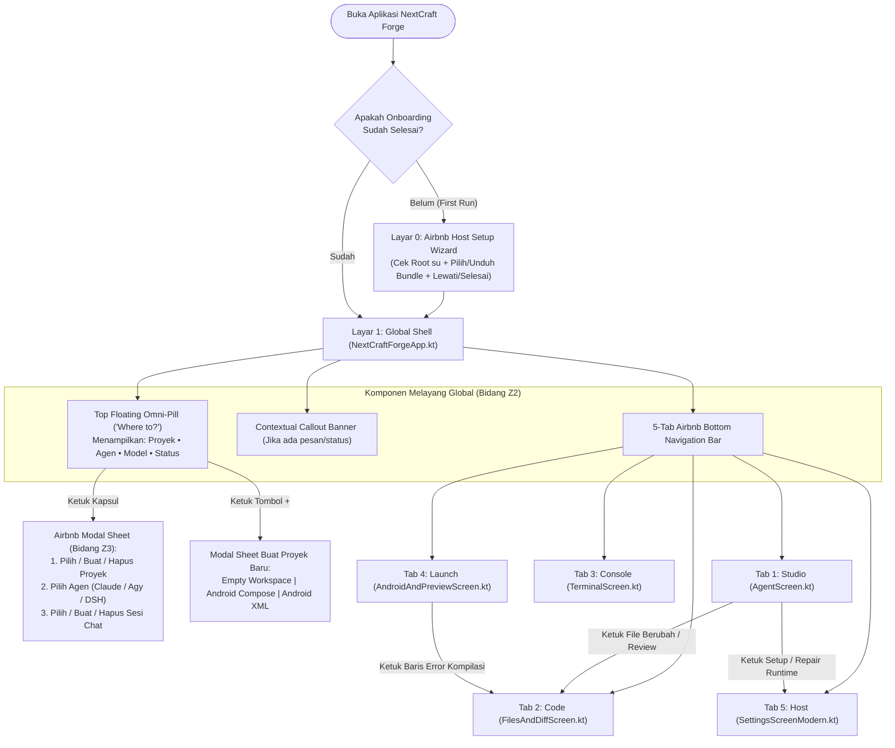

# BLUEPRINT ARSITEKTUR UI/UX 100% — NEXTCRAFT FORGE (EDISI AIRBNB DAYLIGHT DLS)

> **Status Dokumen**: Rancangan Arsitektur Final 100% (Siap Review — **Belum Dieksekusi ke Kode Sumber**)
> **Referensi Desain Utama**: **Airbnb Design Language System (DLS) — Tema Terang (*Airbnb Daylight*) & Tema Gelap (*Airbnb Obsidian*)**
> **Target Implementasi**: Lapisan Presentasi **Blok 5 (`Theme.kt`, `MarkdownText.kt`)** & **Blok 6 (`NextCraftForgeApp.kt`, `AgentScreen.kt`, `FilesAndDiffScreen.kt`, `TerminalScreen.kt`, `AndroidAndPreviewScreen.kt`, `SettingsScreenModern.kt`)** serta **`themes.xml`**.
> **Jaminan Arsitektur**: **0% perubahan pada mesin inti Blok 1–4** dan **100% kompatibilitas penuh dengan seluruh state & fungsi `MainViewModel.kt`**.

---

## DAFTAR ISI
1. [Filosofi Arsitektur & Transformasi Paradigma (Mengapa Gaya Airbnb?)](#1-filosofi-arsitektur--transformasi-paradigma-mengapa-gaya-airbnb)
2. [Diagram Arsitektur Ruang 3D (3-Axis Isometric Spatial Architecture)](#2-diagram-arsitektur-ruang-3d-3-axis-isometric-spatial-architecture)
3. [Spesifikasi Sistem Token Desain 100% (Warna, Tipografi, Geometri, Elevasi)](#3-spesifikasi-sistem-token-desain-100-warna-tipografi-geometri-elevasi)
4. [Diagram Alur Navigasi & Interaksi End-to-End](#4-diagram-alur-navigasi--interaksi-end-to-end)
5. [Blueprint 3D & Wireframe Presisi Piksel untuk Seluruh 7 Layar/Komponen](#5-blueprint-3d--wireframe-presisi-piksel-untuk-seluruh-7-layarkomponen)
   - [5.1. Layar 0 — Airbnb Host Setup Wizard (Onboarding & Instalasi Runtime)](#51-layar-0--airbnb-host-setup-wizard-onboarding--instalasi-runtime)
   - [5.2. Layar 1 — Global Shell, Top Floating Omni-Pill & Workspace Switcher Sheet (`NextCraftForgeApp.kt`)](#52-layar-1--global-shell-top-floating-omni-pill--workspace-switcher-sheet-nextcraftforgeappkt)
   - [5.3. Layar 2 — Studio: Percakapan Multi-Agen & Kartu Persetujuan (`AgentScreen.kt`)](#53-layar-2--studio-percakapan-multi-agen--kartu-persetujuan-agentscreenkt)
   - [5.4. Layar 3 — Code: Explorer, Editor & Unified Diff Review (`FilesAndDiffScreen.kt`)](#54-layar-3--code-explorer-editor--unified-diff-review-filesanddiffscreenkt)
   - [5.5. Layar 4 — Console: Terminal Interaktif ARM64 (`TerminalScreen.kt`)](#55-layar-4--console-terminal-interaktif-arm64-terminalscreenkt)
   - [5.6. Layar 5 — Launch: APK Build Studio, Logcat & Web Preview (`AndroidAndPreviewScreen.kt`)](#56-layar-5--launch-apk-build-studio-logcat--web-preview-androidandpreviewscreenkt)
   - [5.7. Layar 6 — Host Hub: Pengaturan, Brankas API, Bundle & GitHub (`SettingsScreenModern.kt`)](#57-layar-6--host-hub-pengaturan-brankas-api-bundle--github-settingsscreenmodernkt)
6. [Pemetaan 1:1 Seluruh State & Fungsi `MainViewModel.kt` ke Komponen Airbnb](#6-pemetaan-11-seluruh-state--fungsi-mainviewmodelkt-ke-komponen-airbnb)
7. [Rekayasa Anti-Cacat Visual (Zero-Defect Guardrails untuk Tema Terang)](#7-rekayasa-anti-cacat-visual-zero-defect-guardrails-untuk-tema-terang)

---

## 1. Filosofi Arsitektur & Transformasi Paradigma (Mengapa Gaya Airbnb?)

Aplikasi IDE mobile konvensional (seperti Mobile Harness asli) menggunakan paradigma **"Cockpit Pesawat"**: menjejalkan semua tombol, chip agen, tab chat, dan kartu status di bagian atas layar secara bersamaan. Akibatnya:
- **40% ruang layar vertikal habis oleh tumpukan bar atas**, menyisakan ruang baca yang sempit.
- Tampilan terasa sesak, kaku, dan melelahkan mata.

Sebaliknya, **Airbnb Design Language System (DLS)** menggunakan paradigma **"Hospitality-Driven Progressive Disclosure"**:
1. **Satu Kapsul Pintar di Atas (*The "Where to?" Omni-Pill*)**:
   - Menggabungkan *Proyek Aktif*, *Agen AI*, *Model*, *Sesi Chat*, dan *Status Chroot* ke dalam **satu kapsul melayang (`58.dp`)**.
   - Ketika diketuk, barulah membuka **Modal Bottom Sheet** bergaya pencarian Airbnb.
2. **Visual Anchor Pengganti Foto Properti**:
   - Di Airbnb asli, kartu tampak hidup karena adanya foto properti. Di NextCraft Forge, kita menggantinya dengan **Header Kanvas Hangat (`#F7F7F7`)**, **Monogram Badge Berwarna**, **4-Step Progress Stepper**, dan **Mini Code/Diff Preview Frame** dengan lencana status di pojok kanan atas (*"Guest Favorite" style badge*).
3. **Aksi Utama Selalu di Zona Jempol Bawah (*The "Reserve" Action Dock*)**:
   - Setiap aksi utama (*Send Prompt*, *Save File*, *Accept All Changes*, *Install & Launch APK*) ditempatkan di bar bawah yang mengambang dengan tombol kapsul **Rausch Coral (`#FF385C`)** di kanan dan ringkasan konteks di kiri.

---

## 2. Diagram Arsitektur Ruang 3D (3-Axis Isometric Spatial Architecture)

Arsitektur UI Airbnb pada NextCraft Forge disusun dalam **4 bidang kedalaman (Sumbu Z / Elevation Planes)** di atas layar ponsel:

- **Bidang Z3 (Top Overlay Plane — `Elevation 16.dp`)**: *Airbnb Modal Bottom Sheets* (Pemilih Proyek/Agen/Chat, Dialog Proyek Baru, Kartu Konfirmasi Perintah Berbahaya `ToolRequest`).
- **Bidang Z2 (Floating Chrome Plane — `Elevation 6.dp–8.dp`)**: *Top Floating Omni-Pill ("Where to?")*, *Sticky Reserve Action Dock*, dan *5-Tab Airbnb Bottom Navigation Bar*.
- **Bidang Z1 (Editorial Listing Card Plane — `Elevation 0.dp`, Border `1.dp #EBEBEB`)**: Kartu Respons Agen, Kartu Unified Diff, Kartu APK Build Studio, Kartu Blok Kode (`#F7F7F7`), dan Kartu Pengaturan *Host Hub*.
- **Bidang Z0 (Base Alabaster Canvas Plane — `Elevation 0.dp`)**: Kanvas dasar putih bersih `#FFFFFF` (*Airbnb Daylight*) yang menyatu dengan *Status Bar* dan *Navigation Bar* sistem Android.

```text
====================================================================================
       PERSPEKTIF 3D ISOMETRIK — 4 LAPISAN ELEVASI UI AIRBNB DAYLIGHT (SUMBU Z)
====================================================================================

     [ BIDANG Z3: MODAL SHEETS & HIGH-RISK APPROVAL OVERLAYS (Radius Atas 24.dp) ]
            ╭─────────────────────────────────────────────────────────────╮
           /  ━━━━━ (Drag Handle 36x4dp #DDDDDD)                         /|
          /  [ ✕ ]  Switch Workspace, AI Engine & Conversation          / |
         /  +--------------------------------------------------------+ /  |
        /   | 1. WORKSPACE (Where?)    -> forge-notes (/workspace)   |    |
       /    | 2. AI ENGINE (Who?)      -> Claude · Antigravity · DSH |    |
      /     | 3. THREAD (Which Chat?)  -> Session #1 · + New Chat    |    /
     +------+--------------------------------------------------------+---+
                                        │ (Muncul saat Omni-Pill diketuk)
                                        ▼
     [ BIDANG Z2: FLOATING CHROME — OMNI-PILL & STICKY RESERVE DOCK (Shadow 6.dp) ]
        ╭─────────────────────────────────────────────────────────────╮
       /  🔍  forge-notes                            [ ● Ready ] [➕] /|  <-- Top Omni-Pill
      /       Claude Code · claude-sonnet-4-6 · Chat #1             / |      (999.dp Pill)
     +-------------------------------------------------------------+  |
     |                                                             |  |
     |  (Ruang Konten Tengah 80% Layar — Tembus ke Bidang Z1 & Z0) |  |
     |                                                             |  |
     +-------------------------------------------------------------+  |
      \  ⚡ Execute · 3 file berubah      [ Revert ] [ Accept All ] \ |  <-- Sticky Reserve Dock
       \-------------------------------------------------------------\|      (CTA #FF385C)
        \   ✦ Studio     📁 Code(3)    >_ Console    📱 Launch   👤 Host \ <-- Bottom Nav Bar
         +---------------------------------------------------------------+
                                        │
                                        ▼
     [ BIDANG Z1: EDITORIAL LISTING CARDS (Tonal 0.dp, Border Hairline 1.dp #EBEBEB) ]
          ╭─────────────────────────────────────────────────────────╮
         /  ╭─────────────────────────────────────────────────────╮ /|
        /  /  #F7F7F7 Warm Header Anchor           [ +24 / -5 ]  / | | <-- Visual Anchor
       /  +-----------------------------------------------------+  | |     (Pengganti Foto)
      /   |  MainActivity.kt · Diperbarui oleh Claude Code      |  | |
     /    |  + override fun attachBaseContext(newBase: Context) |  | /
    +-----+-----------------------------------------------------+--+
                                        │
                                        ▼
     [ BIDANG Z0: BASE ALABASTER CANVAS (#FFFFFF) + ANDROID SYSTEM BARS ]
      +-----------------------------------------------------------------+
     /  Status Bar #FFFFFF (Ikon Gelap #222222)                         /
    /   Kanvas Utama #FFFFFF (Tanpa Surface Tint Pink/Abu Kotor)       /
   /    Navigation Bar #FFFFFF (Ikon Gelap #222222)                   /
  +------------------------------------------------------------------+
```

---

## 3. Spesifikasi Sistem Token Desain 100% (Warna, Tipografi, Geometri, Elevasi)

### 3.1. Tabel Token Warna Lengkap (`Theme.kt`)

| Nama Token Semantik | Peran di UI | Nilai Hex *Airbnb Daylight* (Light — Default) | Nilai Hex *Airbnb Obsidian* (Dark) | Rasio Kontras & Catatan Rekayasa |
| :--- | :--- | :---: | :---: | :--- |
| `AirbnbRausch` | Primary CTA, Tab Aktif, Badge Utama | `#FF385C` | `#FF385C` | Warna ikonik Airbnb (*Reserve / Search*) |
| `AirbnbRauschDark` | Pressed State / Gradien Akhir CTA | `#E31C5F` | `#D70466` | Digunakan untuk efek gradien/tekan tombol utama |
| `AirbnbRauschSoftBg` | Latar Chip Aktif / Sorotan Halus | `#FFF0F3` | `#331019` | Kontras lembut untuk chip agen/tab yang dipilih |
| `AirbnbBabuText` | Teks Status *Ready / Synced* | `#006C65` | `#2AD2C5` | Kontras tinggi (`6.2:1`) di atas latar `#E6F6F5` |
| `AirbnbBabuSoftBg` | Latar Pill Status *Ready / Synced* | `#E6F6F5` | `#0D2E2B` | Menggantikan hijau neon yang menyilaukan |
| `AirbnbArchesText` | Teks Status *Building / Warning* | `#B33A10` | `#FF8A65` | Terbaca tajam di latar `#FFF3EE` |
| `AirbnbArchesSoftBg` | Latar Pill *Building / Warning* | `#FFF3EE` | `#331810` | Hangat dan jelas untuk indikator proses berjalan |
| `AirbnbDangerText` | Teks *Error / High-Risk Tool / Delete* | `#C13515` | `#FF6B57` | Digunakan pada kartu konfirmasi perintah berbahaya |
| `AirbnbDangerSoftBg` | Latar *Error Banner / High-Risk Card* | `#FFF0EE` | `#361310` | Menarik perhatian tanpa merusak estetika halaman |
| `AirbnbCanvas` | Latar Utama Layar (`Scaffold`) | `#FFFFFF` | `#121212` | Putih murni dengan `surfaceTint = Transparent` |
| `AirbnbSurfaceWarm` | Latar Code Block, Input, Line Gutter | `#F7F7F7` | `#1B1B1E` | Membedakan area teknis dari kanvas putih utama |
| `AirbnbSurfaceChip` | Latar Tombol Bulat & Chip Netral | `#F1F1F1` | `#26262A` | Kontras halus untuk tombol sekunder |
| `AirbnbCardSurface` | Permukaan Kartu (`AirbnbCard`) | `#FFFFFF` | `#1E1E22` | Wajib `tonalElevation = 0.dp` agar tidak berubah pink |
| `AirbnbBorderHairline` | Garis Batas Kartu & Divider (`1.dp`) | `#EBEBEB` | `#2E2E34` | Pengganti bayangan tebal pada kartu daftar |
| `AirbnbBorderStrong` | Garis Batas Omni-Pill & Input Fokus | `#DDDDDD` | `#3E3E46` | Memberikan definisi tegas pada kapsul mengambang |
| `AirbnbTextHof` | Teks Utama (Judul, Chat, Kode) | `#222222` | `#F5F5F7` | Kontras **15.8 : 1** (Standar tertinggi WCAG AAA) |
| `AirbnbTextFoggy` | Teks Sekunder (Subtitle, Path, Waktu) | `#717171` | `#A0A0A8` | Kontras **4.8 : 1** (Lulus WCAG AA) |
| `AirbnbTextMuted` | Placeholder Input & Nomor Baris | `#9E9E9E` | `#6E6E77` | Tidak mengganggu fokus saat membaca kode |
| `AirbnbDiffAddText` | Teks Baris Diff Tambah (`+`) | `#0B4F19` | `#6EE7B7` | Hijau zamrud tua yang sangat tajam di latar terang |
| `AirbnbDiffAddBg` | Latar Baris Diff Tambah (`+`) | `#EBFBF2` | `#0A2E1D` | Dilengkapi strip indikator kiri `3.dp #008A05` |
| `AirbnbDiffDelText` | Teks Baris Diff Hapus (`-`) | `#8C1D2E` | `#FDA4AF` | Merah anggur tua yang nyaman dibaca |
| `AirbnbDiffDelBg` | Latar Baris Diff Hapus (`-`) | `#FFF0F3` | `#331019` | Dilengkapi strip indikator kiri `3.dp #C13515` |

---

### 3.2. Skala Tipografi Editorial (`ForgeTypography`)

| Gaya Teks | Ukuran (`sp`) | Tinggi Baris (`sp`) | Ketebalan (`FontWeight`) | Letter Spacing | Penggunaan Utama |
| :--- | :---: | :---: | :---: | :---: | :--- |
| `headlineLarge` | `26.sp` | `32.sp` | `Bold (700)` | `-0.5.sp` | Judul halaman utama (*Host Hub*, *Onboarding*, *Hero Greeting*) |
| `headlineMedium` | `22.sp` | `28.sp` | `Bold (700)` | `-0.3.sp` | Judul *Modal Bottom Sheet* & Nama Proyek di Kartu Utama |
| `titleLarge` | `18.sp` | `24.sp` | `SemiBold (600)` | `-0.2.sp` | Judul *Listing Card* (Kartu Agen, Kartu APK Studio, Kartu GitHub) |
| `titleMedium` | `15.sp` | `20.sp` | `SemiBold (600)` | `0.sp` | Baris utama *Top Omni-Pill*, nama file di *Diff Card*, tombol CTA |
| `bodyLarge` | `15.sp` | `22.sp` | `Normal (400)` | `0.sp` | Teks percakapan agen (`MarkdownText`), deskripsi pengaturan |
| `bodyMedium` | `13.5.sp` | `19.sp` | `Normal (400)` | `0.sp` | Penjelasan tool, daftar masalah kompilasi, item file tree |
| `labelLarge` | `13.sp` | `18.sp` | `SemiBold (600)` | `0.sp` | Label tab *Category Strip*, tombol kapsul sekunder |
| `labelMedium` | `12.sp` | `16.sp` | `Medium (500)` | `0.1.sp` | Subjudul *Top Omni-Pill*, lencana status (*Ready*, `+N / -M`), label bawah |
| `CodeMonospace` | `12.5.sp` | `18.sp` | `Normal (400)` | `0.sp` | Editor kode, blok kode Markdown, baris *unified diff*, output terminal |

---

### 3.3. Sistem Komponen Bersama (`AirbnbDesignSystem` di dalam `Theme.kt`)

Untuk menjamin konsistensi 100% di seluruh 6 layar, `Theme.kt` menyediakan komponen fondasi berikut:
1. **`AirbnbCard`**: `Surface` dengan `shape = RoundedCornerShape(20.dp)`, `color = AirbnbCardSurface`, `tonalElevation = 0.dp`, `border = BorderStroke(1.dp, AirbnbBorderHairline)`.
2. **`AirbnbSectionHeader`**: Judul bagian bergaya editorial Airbnb (`18.sp SemiBold #222222` di kiri + subjudul `#717171` di bawahnya + opsional aksi teks bergaris bawah di kanan).
3. **`AirbnbPrimaryButton`**: Tombol utama berwarna **Rausch Coral (`#FF385C`)** dengan teks putih `14.sp SemiBold`, `shape = RoundedCornerShape(12.dp)`, tinggi minimal `44.dp`.
4. **`AirbnbSecondaryButton`**: Tombol sekunder dengan latar putih/transparan, border `1.dp #222222` (atau `#EBEBEB`), teks `#222222` `13.5.sp SemiBold`, `shape = RoundedCornerShape(12.dp)`.
5. **`AirbnbPillBadge`**: Lencana kapsul (`RoundedCornerShape(999.dp)`) untuk status *Ready* (Babu Teal), *Building/Warning* (Arches Orange), *Danger/High-Risk* (Rose), atau *Neutral* (`#F1F1F1`).
6. **`AirbnbCategoryStrip`**: Baris sub-tab horizontal berikon dengan indikator garis bawah `2.5.dp` yang menempel presisi di atas divider `1.dp #EBEBEB`.
7. **`AirbnbBottomSheetDialog`**: Dialog lembar bawah berbingkai atas `RoundedCornerShape(topStart = 24.dp, topEnd = 24.dp)` dengan *drag handle* `36.dp x 4.dp` (`#DDDDDD`), header tombol tutup bulat `✕`, dan pembatas tinggi `heightIn(max = 640.dp)`.
8. **`AirbnbStickyReserveBar`**: Bilah aksi bawah mengambang dengan garis batas atas `1.dp #EBEBEB`, menampilkan ringkasan konteks di kiri (`Modifier.weight(1f)`) dan tombol aksi Rausch Coral di kanan.

---

## 4. Diagram Alur Navigasi & Interaksi End-to-End



---

## 5. Blueprint 3D & Wireframe Presisi Piksel untuk Seluruh 7 Layar/Komponen

---

### 5.1. Layar 0 — *Airbnb Host Setup Wizard* (Onboarding & Instalasi Runtime)
**File Target**: [`app/src/main/java/com/nextcraft/forge/ui/NextCraftForgeApp.kt`](file:///workspace/mobilebuilder/app/src/main/java/com/nextcraft/forge/ui/NextCraftForgeApp.kt)

#### Konsep Desain:
Menggantikan halaman setup teknis yang kaku dengan pengalaman seperti **"Airbnb Host Onboarding"**: latar putih bersih, judul editorial besar, kartu pemeriksaan perangkat Root (`su`), kartu progres instalasi 4 bundle `.tar.zst`, dan *Sticky Reserve Bar* di bawah.

```text
+====================================================================+
|  NEXTCRAFT FORGE                                    [ Skip Setup ] |
|  ━━━━━●━━━━━━━━━━━━━━━━━━━━━━━━━━━━━━━━━━━━━━━━━━━━━━━━━━━━━━━━━━  |
|                                                                    |
|  Welcome to your mobile                                            |
|  coding sanctuary.                                                 |
|  Set up your Ubuntu 24.04 ARM64 Root Chroot engine and AI agents   |
|  in a few taps.                                                    |
|                                                                    |
|  ╭──────────────────────────────────────────────────────────────╮  |
|  │  ╭────────────────────────────────────────────────────────╮  │  |
|  │  │  🛡️ KERNEL & ROOT ACCESS                  [ ● Ready ] │  │  |
|  │  ╰────────────────────────────────────────────────────────╯  │  |
|  │  Device Architecture: arm64-v8a                              │  |
|  │  Root Mount Namespace (su -mm): Granted                      │  |
|  │  [ Re-check Root Access ]                                    │  |
|  ╰──────────────────────────────────────────────────────────────╯  |
|                                                                    |
|  ╭──────────────────────────────────────────────────────────────╮  |
|  │  📦 RUNTIME BUNDLES (.tar.zst)                               │  |
|  │  ──────────────────────────────────────────────────────────  │  |
|  │  ☑ Core Ubuntu 24.04.5 LTS + Node 24          [ Installed ]  │  |
|  │  ☑ Claude Code Official ARM64                 [ Installed ]  │  |
|  │  ☑ Google Antigravity CLI                     [ Installed ]  │  |
|  │  ☐ DeepSeek Harness (DSH)                     [ Optional  ]  │  |
|  │                                                              │  |
|  │  [ Import Local .tar.zst ]       [ Verify & Repair Rootfs ]  │  |
|  ╰──────────────────────────────────────────────────────────────╯  |
|                                                                    |
+--------------------------------------------------------------------+
|  Ready to start building              [  Enter Studio (#FF385C)  ] |
+====================================================================+
```

---

### 5.2. Layar 1 — *Global Shell, Top Floating Omni-Pill & Workspace Switcher Sheet*
**File Target**: [`app/src/main/java/com/nextcraft/forge/ui/NextCraftForgeApp.kt`](file:///workspace/mobilebuilder/app/src/main/java/com/nextcraft/forge/ui/NextCraftForgeApp.kt)

#### Konsep Desain:
- Di bagian atas layar hanya ada **1 kapsul melayang (`Top Floating Omni-Pill`)** dengan bayangan lembut `6.dp` dan border `1.dp #DDDDDD`.
- Di sebelah kanan kapsul terdapat tombol bulat **Theme Toggle (`☀️/🌙`)** dan tombol bulat **New Workspace (`➕`)**.
- Mengetuk kapsul utama membuka **Workspace, Agent & Session Switcher Sheet** bergaya pencarian destinasi Airbnb.

```text
+====================================================================+
|  [ KONDISI NORMAL — TOP FLOATING OMNI-PILL (Tinggi 58.dp) ]        |
|  ╭──────────────────────────────────────────────────╮  ╭────╮ ╭────╮|
|  │ ●  forge-notes                      [ Ready ] ⌄  │  │ ☀️ │ │ ➕ │|
|  │    Claude Code · Sonnet 4.6 · Chat #1            │  ╰────╯ ╰────╯|
|  ╰──────────────────────────────────────────────────╯              |
+====================================================================+
                                  │
                     (Saat Omni-Pill Diketuk)
                                  ▼
+====================================================================+
|  [ KONDISI TERBUKA — AIRBNB WORKSPACE & AGENT SWITCHER SHEET ]     |
|                              ━━━━━━                                |
|  ╭────╮                                             ╭────────────╮ |
|  │ ✕  │  Where are we coding?                       │ + New App  │ |
|  ╰────╯                                             ╰────────────╯ |
|  ────────────────────────────────────────────────────────────────  |
|  1. CHOOSE WORKSPACE                                               |
|  ╭──────────────────────────────────────────────────────────────╮  |
|  │  ◉  forge-notes                             [Active]  [ 🗑️ ] │  |
|  │     /workspace/forge-notes · Android Compose                 │  |
|  ├──────────────────────────────────────────────────────────────┤  |
|  │  ○  api-server-node                         [Switch]  [ 🗑️ ] │  |
|  │     /workspace/api-server-node · Workspace                   │  |
|  ╰──────────────────────────────────────────────────────────────╯  |
|                                                                    |
|  2. SELECT AI ENGINE                                               |
|  ╭──────────────────╮  ╭──────────────────╮  ╭──────────────────╮  |
|  │ ● Claude Code    │  │ ○ Antigravity    │  │ ○ DeepSeek DSH   │  |
|  │   Sonnet 4.6     │  │   Gemini / Agy   │  │   Reasoner / V3  │  |
|  ╰──────────────────╯  ╰──────────────────╯  ╰──────────────────╯  |
|  (Kartu aktif memiliki border 2.dp #FF385C & latar #FFF0F3)        |
|                                                                    |
|  3. CONVERSATION THREADS IN THIS WORKSPACE        [ + New Chat ]   |
|  ╭──────────────╮  ╭──────────────╮  ╭──────────────────────────╮  |
|  │ ● Chat #1  ✕ │  │ ○ Bugfix #2  │  │ ○ UI Redesign            │  |
|  ╰──────────────╯  ╰──────────────╯  ╰──────────────────────────╯  |
+====================================================================+
```

---

### 5.3. Layar 2 — *Studio*: Percakapan Multi-Agen & Kartu Persetujuan
**File Target**: [`app/src/main/java/com/nextcraft/forge/ui/AgentScreen.kt`](file:///workspace/mobilebuilder/app/src/main/java/com/nextcraft/forge/ui/AgentScreen.kt)

#### Konsep Desain:
1. **Baris Chip Cepat Tipis di Atas Kanvas (`Quick Context Strip`)**:
   - Menampilkan kapsul sesi chat aktif + tombol `+ Chat` serta status kesiapan agen jika belum siap.
2. **Kartu Kontekstual Prioritas (Hanya Muncul Bila Diperlukan)**:
   - **Kartu Runtime Setup**: Muncul jika bundle agen yang dipilih belum terpasang.
   - **Kartu Login OAuth Google Antigravity**: Muncul jika agen `Antigravity` dipilih namun belum login (`Start OAuth`, `Open Browser`, `Paste Callback URL`, `Cancel`).
   - **Kartu Ringkasan Perubahan Workspace (`Pending Diff Summary`)**: Muncul jika ada file yang dimodifikasi agen (`N files changed`), dilengkapi tombol **Review Diff**, **Undo All**, dan **Accept All**.
3. **Aliran Pesan Bergaya Editorial Airbnb**:
   - **Empty State**: Menampilkan sapaan hangat + **3 Kartu Starter Prompt** bergaya *Airbnb Experience Card* yang langsung mengisi/mengirim prompt saat diketuk.
   - **Pesan User**: Kapsul gelap elegan (`#222222`, teks putih `#FFFFFF`, sudut `20.dp`) di sisi kanan.
   - **Pesan Assistant (Agen)**: Kartu putih penuh (`#FFFFFF`, border `1.dp #EBEBEB`, sudut `20.dp`) dengan *header* avatar monogram agen + nama model + waktu, isi `MarkdownText` yang bersih, serta **Collapsible Tool Amenity Pill** (`🔧 3 tools executed · Ketuk untuk detail ⌄`).
4. **Kartu Konfirmasi Perintah Berisiko Tinggi (`ToolRequest` Approval)**:
   - Mengambang tepat di atas *Composer* dengan gaya **Airbnb Booking Request Card**: lencana merah/oranye `High-Risk Action`, penjelasan tool, kotak pratinjau perintah monospasi `#F7F7F7`, serta tombol **Deny** (Outline) dan **Allow** (`#FF385C`).
5. **Floating Prompt Composer (Bawah)**:
   - Kapsul input melayang (`RoundedCornerShape(24.dp)`, border `1.dp #DDDDDD`) dengan pemilih mode **`⚡ Execute` | `📋 Plan`** dan tombol bulat **Send (`#FF385C`)** / **Stop (`#C13515`)**.

```text
+====================================================================+
|  [ LAYAR 2: STUDIO (AgentScreen.kt) ]                              |
|  ╭──────────────╮ ╭──────────────╮ ╭───────────╮                   |
|  │ ● Chat #1  ✕ │ │ ○ Chat #2    │ │ + New Chat│     [ Clear ]     |
|  ╰──────────────╯ ╰──────────────╯ ╰───────────╯                   |
|  ────────────────────────────────────────────────────────────────  |
|                                                                    |
|  ╭──────────────────────────────────────────────────────────────╮  |
|  │ ✨ 3 files modified in workspace              [ +42 / -11 ]  │  |
|  │ MainActivity.kt, Theme.kt, AgentScreen.kt                    │  |
|  │ [ Undo All ]        [ Accept All ]        [ Review Diff ↗ ]  │  |
|  ╰──────────────────────────────────────────────────────────────╯  |
|                                                                    |
|                       ╭─────────────────────────────────────────╮  |
|                       │ Buat halaman daftar catatan dengan      │  |
|                       │ pencarian real-time di Compose.         │  |
|                       ╰─────────────────────────────────────────╯  |
|                                                                    |
|  ╭──────────────────────────────────────────────────────────────╮  |
|  │ [C]  Claude Code · claude-sonnet-4-6                Just now │  |
|  │ ──────────────────────────────────────────────────────────── │  |
|  │  ╭────────────────────────────────────────────────────────╮  │  |
|  │  │ 🔧 3 tool actions · Read 1 file, Edited 2 files     ⌄ │  │  |
|  │  ╰────────────────────────────────────────────────────────╯  │  |
|  │                                                              │  |
|  │  Saya telah menambahkan komponen pencarian real-time pada    │  |
|  │  layar utama catatan Anda:                                   │  |
|  │                                                              │  |
|  │  ╭────────────────────────────────────────────────────────╮  │  |
|  │  │ kotlin                                       [ Copy ]  │  │  |
|  │  ├────────────────────────────────────────────────────────┤  │  |
|  │  │ val filtered = notes.filter { it.contains(query) }     │  │  |
|  │  ╰────────────────────────────────────────────────────────╯  │  |
|  ╰──────────────────────────────────────────────────────────────╯  |
|                                                                    |
|  ╭──────────────────────────────────────────────────────────────╮  |
|  │ ⚠️ APPROVAL REQUIRED                       [ High Risk ]     │  |
|  │ Bash · Clean previous build output                           │  |
|  │ ╭──────────────────────────────────────────────────────────╮ │  |
|  │ │ $ rm -rf app/build/outputs/apk/debug                     │ │  |
|  │ ╰──────────────────────────────────────────────────────────╯ │  |
|  │ [      Deny      ]                [    Allow (#FF385C)     ] │  |
|  ╰──────────────────────────────────────────────────────────────╯  |
|                                                                    |
|  ╭──────────────────────────────────────────────────────────────╮  |
|  │ Ask Claude Code to build, refactor, or fix...                │  |
|  │                                                              │  |
|  │ [ ⚡ Execute | 📋 Plan ]                        (  Send ↗  ) │  |
|  ╰──────────────────────────────────────────────────────────────╯  |
+====================================================================+
```

---

### 5.4. Layar 3 — *Code*: Explorer, Editor & Unified Diff Review
**File Target**: [`app/src/main/java/com/nextcraft/forge/ui/FilesAndDiffScreen.kt`](file:///workspace/mobilebuilder/app/src/main/java/com/nextcraft/forge/ui/FilesAndDiffScreen.kt)

#### Konsep Desain:
1. **Airbnb Category Strip (Atas)**:
   - 3 kategori berikon dengan garis bawah aktif `2.5.dp`:
     - `🗂️ Explorer` | `✨ Changes (N)` | `🔎 Search`
2. **Sub-Tab 1 — *Explorer & Code Editor***:
   - *Breadcrumb Pill Strip* (`Up ⬆️`, `/workspace/forge-notes/app/...`, `+ File`, `+ Folder`, `Refresh`).
   - Daftar folder & file dalam bentuk kartu bersih dengan ikon direktori/file dan ukuran byte.
   - **Code Editor Card**:
     - Header menampilkan path file + indikator titik **Rausch Coral (`● Unsaved`)** jika ada perubahan yang belum disimpan.
     - **Pinned Line-Number Gutter (`#F7F7F7`)** di sebelah kiri (`40.dp`) + area ketik monospasi `#FFFFFF` di kanan.
     - **Sticky Reserve Save Bar** di bawah: menampilkan jumlah baris & status file di kiri + tombol **`Save File` (`#FF385C`)** di kanan.
3. **Sub-Tab 2 — *Changes (Unified Diff Viewer)***:
   - Setiap file yang berubah ditampilkan sebagai **Airbnb Inspection Card**:
     - Header kartu: Nama file + lencana `+Additions` (`#EBFBF2` / `#0B4F19`) dan `-Deletions` (`#FFF0F3` / `#8C1D2E`) + tombol `Open` / `Revert` / `Accept`.
     - Isi kartu: Baris *unified diff* dengan strip warna `3.dp` di sisi kiri (`#008A05` untuk `+`, `#C13515` untuk `-`).
   - **Sticky Review Dock (Bawah)**: Menampilkan total file berubah di kiri + tombol **`Revert All`** dan **`Accept All` (`#FF385C`)** di kanan.
4. **Sub-Tab 3 — *Search in Files***:
   - Kapsul pencarian bergaya Airbnb dengan hasil pencarian per baris yang langsung membuka file di *Editor* saat diketuk.

```text
+====================================================================+
|  [ LAYAR 3: CODE — SUB-TAB CHANGES / UNIFIED DIFF ]                |
|     🗂️ Explorer           ✨ Changes (2)           🔎 Search       |
|                         ━━━━━━━━━━━━━━━                            |
|  ────────────────────────────────────────────────────────────────  |
|                                                                    |
|  ╭──────────────────────────────────────────────────────────────╮  |
|  │ 📄 app/src/main/.../MainActivity.kt       [ +12 ]  [ -3 ]    │  |
|  │ ──────────────────────────────────────────────────────────── │  |
|  │ │   override fun onCreate(savedInstanceState: Bundle?) {     │  |
|  │ ┃-      setTheme(R.style.OldDarkTheme)      (Bg #FFF0F3)     │  |
|  │ ┃+      NextCraftForgeTheme(themeMode = "light") (Bg #EBFBF2)│  |
|  │ │       super.onCreate(savedInstanceState)                   │  |
|  │ ──────────────────────────────────────────────────────────── │  |
|  │ [ Open in Editor ]            [ Revert ]    [ Accept File ]  │  |
|  ╰──────────────────────────────────────────────────────────────╯  |
|                                                                    |
+--------------------------------------------------------------------+
|  2 files modified in workspace     [ Revert All ] [ Accept All ]   |
+====================================================================+
```

---

### 5.5. Layar 4 — *Console*: Terminal Interaktif ARM64
**File Target**: [`app/src/main/java/com/nextcraft/forge/ui/TerminalScreen.kt`](file:///workspace/mobilebuilder/app/src/main/java/com/nextcraft/forge/ui/TerminalScreen.kt)

#### Konsep Desain:
- **Header Editorial Ringkas**: Menampilkan direktori aktif (`/workspace/<slug>`), indikator status eksekusi (`Running...` / `Idle`), serta tombol `Copy` dan `Clear`.
- **Horizontal Quick-Command Filter Pills (Gaya Filter Airbnb)**:
  - Kapsul berbingkai `1.dp #DDDDDD`: `ls -la`, `git status`, `gradle assembleDebug`, `node -v`, `claude --version`, `agy --version`, `dsh --version`.
- **Framed Console Output Card (`RoundedCornerShape(20.dp)`)**:
  - Di Tema Terang, menggunakan kanvas **Warm Paper (`#F7F7F7`)** dengan header bar `#EFEFEF` (tiga titik indikator jendela + label `chroot@ubuntu-24.04`) dan teks monospasi `#222222` yang sangat tajam (serta otomatis beralih ke `#141416` saat Tema Gelap aktif).
- **Sticky Command Composer (Bawah)**:
  - Input kapsul dengan simbol `$` berwarna **Rausch Coral (`#FF385C`)** dan tombol **`Run` (`#FF385C`)**.

```text
+====================================================================+
|  [ LAYAR 4: CONSOLE (TerminalScreen.kt) ]                          |
|  Terminal Console                            [ Copy ]   [ Clear ]  |
|  /workspace/forge-notes · Ubuntu 24.04 ARM64                       |
|                                                                    |
|  ╭─────────╮ ╭────────────╮ ╭──────────────────────╮ ╭──────────╮  |
|  │ $ ls -la│ │ $ git stat │ │ $ gradle assembleDbg │ │ $ node -v│  |
|  ╰─────────╯ ╰────────────╯ ╰──────────────────────╯ ╰──────────╯  |
|                                                                    |
|  ╭──────────────────────────────────────────────────────────────╮  |
|  │ ● ● ●   root@ubuntu-24.04:/workspace/forge-notes      [Idle] │  |
|  ├──────────────────────────────────────────────────────────────┤  |
|  │ $ node -v                                                    │  |
|  │ v24.19.0                                                     │  |
|  │                                                              │  |
|  │ $ git status -sb                                             │  |
|  │ ## main...origin/main                                        │  |
|  ╰──────────────────────────────────────────────────────────────╯  |
|                                                                    |
|  ╭──────────────────────────────────────────────────────────────╮  |
|  │  $   Enter shell command in workspace...        [   Run   ]  │  |
|  ╰──────────────────────────────────────────────────────────────╯  |
+====================================================================+
```

---

### 5.6. Layar 5 — *Launch*: APK Build Studio, Logcat & Web Preview
**File Target**: [`app/src/main/java/com/nextcraft/forge/ui/AndroidAndPreviewScreen.kt`](file:///workspace/mobilebuilder/app/src/main/java/com/nextcraft/forge/ui/AndroidAndPreviewScreen.kt)

#### Konsep Desain:
1. **Airbnb Category Strip (Atas)**:
   - `📦 APK Studio` | `📜 Device Logcat` | `🌐 Web Preview`
2. **Sub-Tab 1 — *APK Studio* (Gaya *Airbnb Reservation / Trip Status Card*)**:
   - **Visual Anchor Header (`#F7F7F7`)**: Menampilkan nama aplikasi, `packageName`, lencana status (`APK Ready` / `Compiling` / `Failed`), dan waktu/ukuran file APK.
   - **4-Step Horizontal Build Stepper**:
     - `1. Resolve` $\rightarrow$ `2. Compile` $\rightarrow$ `3. Package` $\rightarrow$ `4. Ready` dengan bilah progres **Rausch Coral (`#FF385C`)**.
   - **Kartu *Compiler Issues* (Jika Ada Error)**:
     - Menampilkan daftar error `kotlinc`/`javac`/`aapt2` dengan lencana `File:Line`. Mengetuk kartu error langsung membuka file tersebut di tab **Code**!
   - **Kartu *Build Output Log* (Collapsible)**:
     - Log detail Gradle yang bisa dibuka/ditutup dan disalin.
   - **Sticky Launch Dock (Bawah)**:
     - Kiri: Ringkasan status APK (`"app-debug.apk ready"` atau `"Build in progress..."`)
     - Kanan: Tombol `[ Clean ]`, `[ Build APK ]`, dan tombol utama **`[ Install & Launch ]` (`#FF385C`)**.
3. **Sub-Tab 2 — *Device Logcat***:
   - Filter kapsul (`All`, `Errors`, `App`) + tombol `Refresh`, `Copy`, `Clear` + kanvas log monospasi.
4. **Sub-Tab 3 — *Web Preview***:
   - Bar URL kapsul + deretan *Detected Port Pills* (`:3000`, `:5173`, `:8080`) + tombol `Scan Ports` + `WebView` interaktif berbingkai bersih.

```text
+====================================================================+
|  [ LAYAR 5: LAUNCH — SUB-TAB APK STUDIO ]                          |
|     📦 APK Studio          📜 Device Logcat         🌐 Web Preview |
|   ━━━━━━━━━━━━━━━━                                                 |
|  ────────────────────────────────────────────────────────────────  |
|                                                                    |
|  ╭──────────────────────────────────────────────────────────────╮  |
|  │  ╭────────────────────────────────────────────────────────╮  │  |
|  │  │ 🤖 ANDROID APPLICATION                [ ● APK Ready ]  │  │  |
|  │  │ Forge Notes · com.nextcraft.forge_notes                │  │  |
|  │  │ app/build/outputs/apk/debug/app-debug.apk              │  │  |
|  │  ╰────────────────────────────────────────────────────────╯  │  |
|  │                                                              │  |
|  │  Build Pipeline Progress                               100%  │  |
|  │  ██████████████████████████████████████████████████████████  │  |
|  │  ✓ 1. Resolve    ✓ 2. Compile    ✓ 3. Package    ● 4. Ready  │  |
|  │                                                              │  |
|  │  [ Clean Build ]                      [ Copy Gradle Output ] │  |
|  ╰──────────────────────────────────────────────────────────────╯  |
|                                                                    |
+--------------------------------------------------------------------+
|  Debug APK Ready                 [ Build APK ] [ Install & Launch ]|
+====================================================================+
```

---

### 5.7. Layar 6 — *Host Hub*: Pengaturan, Brankas API, Bundle & GitHub
**File Target**: [`app/src/main/java/com/nextcraft/forge/ui/SettingsScreenModern.kt`](file:///workspace/mobilebuilder/app/src/main/java/com/nextcraft/forge/ui/SettingsScreenModern.kt)

#### Konsep Desain:
Dirancang mengikuti halaman **Airbnb Profile & Host Dashboard** yang terkenal sangat rapi:
1. **Header Editorial**: Judul `"Forge Host Hub"` + lencana versi aplikasi & status Root.
2. **Hero Engine Banner Card (Gaya Kartu *"Airbnb your place"*)**:
   - Menampilkan status kesehatan **Ubuntu 24.04.5 LTS ARM64 Rootfs**, indikator kompatibilitas kernel, serta tombol aksi cepat **Install Recommended** dan **Verify & Repair**.
3. **5 Kartu Kategori Akordeon Bergaya Airbnb (*Expandable Host Sections*)**:
   - Agar halaman tidak menjadi formulir raksasa sepanjang 3 meter, pengaturan dikelompokkan menjadi **5 Kartu Utama** yang masing-masing menampilkan ringkasan status aktif di header-nya dan bisa dibuka/ditutup dengan mulus:
     1. **🔑 AI Providers & Encrypted Key Vault**:
        - Pemilih kapsul penyedia (`Anthropic`, `OpenRouter`, `DeepSeek`, `OpenAI`, `Kimi`, `OpenCode Zen`, `NVIDIA`, `Local`), input `API Key` & `Multi-Key Pool` (rotasi otomatis saat HTTP 429/401), `Base URL`, tombol `Validate Connection`, `Fetch Models`, serta chip pemilihan model dari katalog.
     2. **📦 Runtime Bundles (`.tar.zst`) & Rootfs Maintenance**:
        - Kartu per komponen (`Core`, `Claude Code`, `Antigravity CLI`, `DeepSeek Harness`) lengkap dengan versi terpasang, tombol `Download Official`, `Import .tar.zst`, `Clean Staging`, dan `Reset Runtime`.
     3. **🐙 GitHub Cloud Sync & Repositories**:
        - Input Personal Access Token (PAT), profil akun terhubung, toggle **Auto-Sync to GitHub**, tombol `Commit & Push`, `Pull Latest`, `Create Remote Repo`, serta daftar repositori dengan tombol `Clone`.
     4. **🎨 Appearance, Language & Safety Policy**:
        - Pemilih tema (`Airbnb Daylight`, `Airbnb Obsidian`, `System Default`), pemilih 7 bahasa (`AppLanguage`), dan toggle **Interactive High-Risk Tool Approvals**.
     5. **⬆️ Application Updates (`AppUpdater`)**:
        - Pemeriksaan pembaruan aplikasi, catatan rilis, dan tombol unduh/instal APK pembaruan berverifikasi `SHA-256`.

---

## 6. Pemetaan 1:1 Seluruh State & Fungsi `MainViewModel.kt` ke Komponen Airbnb

Tabel ini menjadi **kontrak verifikasi** bahwa 100% fitur pada [`MainViewModel.kt`](file:///workspace/mobilebuilder/app/src/main/java/com/nextcraft/forge/ui/MainViewModel.kt) terhubung penuh ke UI Airbnb tanpa ada satu pun yang terputus:

| Grup Fitur | State di `MainUiState` | Fungsi di `MainViewModel` | Lokasi Komponen di UI Airbnb DLS |
| :--- | :--- | :--- | :--- |
| **Navigasi & Onboarding** | `selectedTab`, `onboardingDone`, `themeMode`, `bannerMessage` | `selectTab()`, `completeOnboarding()`, `cycleThemeMode()`, `dismissBanner()` | `NextCraftForgeApp.kt`: *Onboarding Wizard*, *Top Omni-Pill*, *Callout Banner*, *Bottom Nav* |
| **Manajemen Proyek** | `projects`, `activeProjectId`, `activeProject` | `selectProject()`, `createProject()`, `deleteProject()` | `NextCraftForgeApp.kt`: *Workspace Switcher Sheet* & *New Project Sheet* |
| **Agen & Percakapan** | `selectedAgent`, `chats`, `activeChatId`, `activeMessages`, `promptInput`, `executionMode`, `isBusy` | `selectAgent()`, `selectChat()`, `createNewChat()`, `deleteChat()`, `updatePromptInput()`, `setExecutionMode()`, `sendPrompt()`, `stopActiveSession()`, `clearConversation()` | `NextCraftForgeApp.kt` (*Omni-Pill Sheet*) & `AgentScreen.kt` (*Quick Strip*, *Chat Listing Cards*, *Floating Composer*) |
| **Persetujuan Tool (`RiskLevel.HIGH`)** | `pendingApproval` (`ToolRequest`) | `respondToToolRequest(approved)` | `AgentScreen.kt`: *High-Risk Booking-Style Approval Card* |
| **OAuth Antigravity** | `antigravityAuth` (`AntigravityAuthUiState`) | `startAntigravityAuth()`, `openAntigravityAuthUrlInBrowser()`, `submitAntigravityCallback()`, `cancelAntigravityAuth()` | `AgentScreen.kt`: *Antigravity Account Verification Card* |
| **Penjelajah File & Editor** | `filesSubTab`, `currentBrowsePath`, `directoryEntries`, `openFilePath`, `editorContent`, `editorDirty` | `setFilesSubTab()`, `browseDirectory()`, `navigateUpDirectory()`, `openFile()`, `updateEditorContent()`, `saveOpenFile()`, `createNewFile()`, `createNewFolder()`, `refreshWorkspaceFiles()` | `FilesAndDiffScreen.kt` (*Sub-Tab Explorer*): *Breadcrumb Pills*, *Pinned Gutter Editor*, *Sticky Save Bar* |
| **Review Diff & Checkpoints** | `changedPaths`, `changeDetails` (`WorkspaceFileChange`) | `acceptChangedFile()`, `revertChangedFile()`, `acceptAllChanges()`, `undoLastChanges()` | `AgentScreen.kt` (*Summary Card*) & `FilesAndDiffScreen.kt` (*Sub-Tab Changes* + *Sticky Review Dock*) |
| **Pencarian Kode** | `searchQuery`, `searchResults` (`SearchResultItem`) | `updateSearchQuery()`, `openFile()` | `FilesAndDiffScreen.kt` (*Sub-Tab Search*) |
| **Terminal Interaktif** | `terminalOutput`, `terminalCommandInput`, `terminalRunning` | `updateTerminalCommandInput()`, `runTerminalCommand()`, `clearTerminalOutput()` | `TerminalScreen.kt`: *Quick Command Pills*, *Framed Console*, *Command Bar* |
| **Android Build, Logcat & Web Preview** | `androidSubTab`, `isAndroidProject`, `androidBuild`, `androidLogcat`, `previewUrl`, `detectedOpenPorts` | `setAndroidSubTab()`, `runAndroidBuild()`, `runAndroidClean()`, `installBuiltDebugApk()`, `openBuildIssue()`, `setLogcatFilter()`, `refreshLogcat()`, `clearLogcat()`, `updatePreviewUrl()`, `scanLocalPreviewPorts()`, `selectPreviewPort()` | `AndroidAndPreviewScreen.kt`: *APK Studio Card*, *4-Step Stepper*, *Sticky Launch Dock*, *Logcat View*, *WebView Preview* |
| **AI Providers & Key Vault** | `selectedProviderKind`, `providerProfiles`, `activeProviderProfile`, `apiKeyInput`, `keyPoolInput`, `isValidatingProvider`, `providerValidationMessage`, `catalogModels` | `selectProviderForEditing()`, `updateActiveProviderProfile()`, `updateApiKeyInput()`, `updateKeyPoolInput()`, `saveProviderAndKeys()`, `validateActiveProvider()`, `fetchModelsForActiveProvider()` | `SettingsScreenModern.kt`: Kartu *AI Providers & Encrypted Key Vault* |
| **Runtime Bundles & Rootfs** | `runtimeStatus`, `bundleRecords`, `setupSnapshot`, `isInstallingRuntime` | `refreshRuntimeStatus()`, `installRecommendedRuntime()`, `downloadSingleBundle()`, `importLocalBundle()`, `verifyAndRepairRuntime()`, `cleanRuntimeStaging()`, `resetRuntimeComplete()` | `SettingsScreenModern.kt`: *Hero Engine Banner Card* & Kartu *Runtime Bundles* |
| **GitHub Cloud Sync** | `githubTokenInput`, `githubAccount`, `githubRepos`, `githubCommitMessage`, `githubStatusMessage`, `isSyncingGitHub`, `autoSyncGitHub` | `updateGitHubTokenInput()`, `connectGitHub()`, `disconnectGitHub()`, `updateGitHubCommitMessage()`, `pushActiveProjectToGitHub()`, `pullActiveProjectFromGitHub()`, `createGitHubRepositoryForActiveProject()`, `cloneGitHubRepository()`, `setAutoSyncGitHub()` | `SettingsScreenModern.kt`: Kartu *GitHub Cloud Sync & Repositories* |
| **Bahasa, Keamanan & Update** | `languageCode`, `interactiveHighRiskApprovals`, `updateInfo`, `isCheckingUpdate`, `updateStatusMessage` | `setLanguage()`, `setInteractiveHighRiskApprovals()`, `checkForUpdates()`, `downloadAndInstallUpdate()` | `SettingsScreenModern.kt`: Kartu *Appearance & Safety* dan Kartu *Application Updates* |

---

## 7. Rekayasa Anti-Cacat Visual (Zero-Defect Guardrails untuk Tema Terang)

Untuk memastikan tidak ada cacat sedikit pun saat diimplementasikan nanti:
1. **Zero Pink Tint (`surfaceTint = Color.Transparent`, `tonalElevation = 0.dp`)**: Kartu putih `#FFFFFF` dijamin 100% tetap putih bersih di Material 3, dipisahkan oleh garis tepi `1.dp #EBEBEB`.
2. **Sinkronisasi Status Bar & Navigation Bar Android (`WindowInsetsControllerCompat`)**: Saat Tema Terang aktif, bar sistem berwarna `#FFFFFF` dengan ikon jam, sinyal, dan baterai berwarna gelap `#222222` (`isAppearanceLightStatusBars = true`).
3. **Kontrak Anti-Terpotong (`Modifier.weight(1f)` + `TextOverflow.Ellipsis`)**: Seluruh judul panjang, path `/workspace/...`, dan ID model berada di dalam container berbobot fleksibel sehingga tombol aksi di sebelah kanan tidak pernah terdorong keluar layar.
4. **Default Tema Terang (*Airbnb Daylight*)**: Default `themeMode` disetel ke `"light"` agar pengalaman pertama langsung menampilkan identitas visual Airbnb yang cerah, hangat, dan bersih, sambil tetap menyediakan *1-tap toggle* ke *Airbnb Obsidian (Dark)*.
5. **Kompatibilitas Penuh Compose BOM `2022.10.00`**: Seluruh komponen kustom (`AirbnbBottomSheetDialog`, `AirbnbCategoryStrip`, `AirbnbCard`, `AirbnbStickyReserveBar`) dibangun menggunakan primitif Compose 1.3 / Material 3 1.0 yang telah teruji lulus kompilasi `K2JVMCompiler` + Compose IR `1.5.10`.
