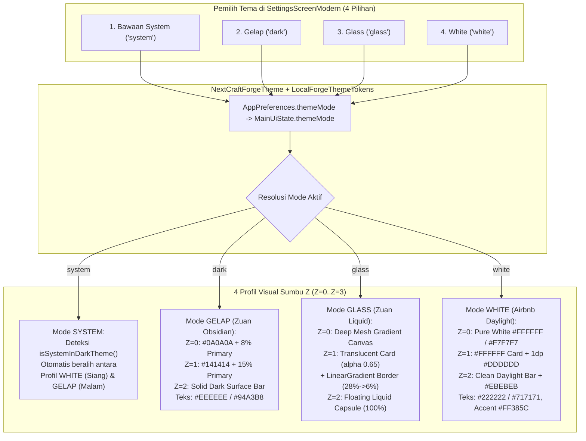

# NextCraft Forge — Arsitektur 100% Multi-Theme Engine (4 Mode: Bawaan System, Gelap, Glass, White)

> **Status Dokumen**: Cetak Biru Arsitektur Multi-Tema 100% (*4-Mode Theme Engine Blueprint — Siap Eksekusi*).
> **Empat Pilihan Mode Tema Resmi**:
> 1. **Bawaan System (`system`)** — Mengikuti tema aktif sistem operasi Android (`isSystemInDarkTheme()`) secara otomatis + dukungan palet adaptif.
> 2. **Gelap (`dark`)** — *Zuan Tinted Obsidian Dark*: Kanvas hitam pekat berdimensi (`#0A0A0A` + 8% Primary tint) dengan kartu Bento (`#141414` + 15% Primary tint) untuk kontras kode & terminal maksimal di malam hari.
> 3. **Glass (`glass`)** — *Zuan Liquid Glassmorphism*: Kanvas kosmik bergradasi dengan kartu kaca semi-transparan (`alpha = 0.68f`), garis tepi pantulan cahaya (*specular gradient border* `White 28% -> 6%`), dan kapsul navigasi melayang (`RoundedCornerShape(100)`).
> 4. **White (`white`)** — *Airbnb Daylight Pure White*: Kanvas putih murni (`#FFFFFF`) & permukaan sekunder (`#F7F7F7`), kartu putih dengan garis tepi tipis `1.dp` (`#DDDDDD`), tipografi tinta gelap (`#222222` & `#717171`), serta aksen *Airbnb Rausch* (`#FF385C`).

---

## 1. Diagram 3D Isometric: Transformasi 4 Mode Tema pada Sumbu Z (`Z=0` s/d `Z=3`)

Setiap halaman di **NextCraft Forge** menggunakan satu struktur komponen yang sama, namun seluruh permukaan, border, transparansi, dan navigasi pada sumbu **Z-Axis** berubah secara reaktif melalui `LocalForgeThemeTokens` sesuai pilihan pengguna:

```
====================================================================================================
                     ARSITEKTUR 3D MULTI-THEME ENGINE (4 PILIHAN TEMA)
====================================================================================================

  [1] BAWAAN SYSTEM (system)                  [2] GELAP / DARK (dark)
  +----------------------------------------+  +----------------------------------------+
  | Z=3 Modal : Auto (Putih / Obsidian)    |  | Z=3 Modal : #1C2330 + 1dp #2E3A4E      |
  | Z=2 Nav   : Auto Bar (Daylight / Dark) |  | Z=2 Nav   : #111827 Top & Bottom Bar   |
  | Z=1 Card  : Auto Surface + 1dp Border  |  | Z=1 Card  : #141414 + 15% Primary Tint |
  | Z=0 Canvas: isSystemInDarkTheme()      |  | Z=0 Canvas: #0A0A0A + 8% Primary Tint  |
  +----------------------------------------+  +----------------------------------------+

  [3] GLASS / LIQUID (glass)                  [4] WHITE / DAYLIGHT (white)
  +----------------------------------------+  +----------------------------------------+
  | Z=3 Modal : Frosted Glass (Alpha 0.78) |  | Z=3 Modal : #FFFFFF + Shadow 16dp      |
  | Z=2 Nav   : Liquid Capsule (Shape 100%)|  | Z=2 Nav   : #FFFFFF + 1dp #EBEBEB Line |
  | Z=1 Card  : Glass Alpha 0.65 + Specular|  | Z=1 Card  : #FFFFFF + 1dp #DDDDDD Line |
  | Z=0 Canvas: Radial Mesh Gradient       |  | Z=0 Canvas: #FFFFFF & #F7F7F7 Daylight |
  +----------------------------------------+  +----------------------------------------+
```

### Alur Reaktif 3D Multi-Theme Engine (Mermaid Architecture)



---

## 2. Matriks Token Lengkap untuk 4 Mode Tema (`ForgeThemeTokens`)

Berikut adalah spesifikasi nilai warna, transparansi, *border brush*, radius sudut, dan permukaan terminal/kode untuk masing-masing dari **4 pilihan tema**:

| Token / Lapisan 3D | 1. `SYSTEM` (Bawaan Sistem) | 2. `DARK` (Gelap — Zuan Obsidian) | 3. `GLASS` (Liquid Glassmorphism) | 4. `WHITE` (Airbnb Daylight White) |
| :--- | :--- | :--- | :--- | :--- |
| **Kode Preferensi (`themeMode`)** | `"system"` | `"dark"` | `"glass"` | `"white"` |
| **Deteksi Gelap/Terang** | `isSystemInDarkTheme()` | Selalu Gelap (`true`) | Berbasis Kosmik Transparan (`true`) | Selalu Terang/Putih (`false`) |
| **Z=0 Base Canvas (`background`)** | Mengikuti `WHITE` (Siang) / `DARK` (Malam) | `#0B0F17` (Obsidian + 8% Primary Tint) | Gradasi `#090D16` → `#111C2D` → `#0D1322` | `#FFFFFF` (Putih Murni 100%) |
| **Z=0 Secondary Canvas (`surfaceSubtle`)** | Mengikuti `WHITE` / `DARK` | `#111827` | `#141E30` (`alpha = 0.55f`) | `#F7F7F7` (Airbnb Warm Alabaster) |
| **Z=1 Card Surface (`cardBackground`)** | Mengikuti `WHITE` / `DARK` | `#161F30` (15% Primary di atas `#141414`) | `#1E293B` dengan `alpha = 0.62f` (Frosted) | `#FFFFFF` (Pure White Card) |
| **Z=1 Card Border (`cardBorder`)** | `1.dp` (`#DDDDDD` atau `#263248`) | `1.dp` Solid `#263248` | `0.8.dp` `LinearGradient(White 28% -> White 6%)` | `1.dp` Solid `#DDDDDD` (Hairline Airbnb) |
| **Z=1 Card Corner Radius** | `16.dp` | `20.dp` (Zuan Bento Squircle) | `24.dp` (Liquid Expressive) | `16.dp` (Airbnb Editorial Card) |
| **Z=1 Squircle Icon Box** | `primaryContainer` | `48.dp`, `RoundedCorner(14.dp)`, `primary(20%)` | `48.dp`, `RoundedCorner(16.dp)`, `White(12%)` | `44.dp`, `RoundedCorner(12.dp)`, `#FFF0F3` |
| **Warna Aksen Utama (`primary`)** | `#0284C7` (Siang) / `#38BDF8` (Malam) | `#38BDF8` (Forge Cyan) | `#60A5FA` (Liquid Electric Blue) | `#FF385C` (Airbnb Rausch Coral) |
| **Warna Aksen Sekunder (`secondary`)** | `#059669` (Siang) / `#34D399` (Malam) | `#34D399` (Emerald) | `#2DD4BF` (Liquid Mint Teal) | `#008489` (Airbnb Babu Teal) |
| **Teks Utama (`onBackground` / `onSurface`)** | `#111111` (Siang) / `#EEEEEE` (Malam) | `#EEEEEE` (Crisp Off-White) | `#F8FAFC` (Pure Ice White) | `#222222` (Airbnb Hof Charcoal) |
| **Teks Sekunder (`onSurfaceVariant`)** | `#666666` (Siang) / `#94A3B8` (Malam) | `#94A3B8` (Muted Slate) | `#CBD5E1` (Frosted Silver) | `#717171` (Airbnb Foggy Grey) |
| **Z=2 Navigation Bar Style** | Standar Bar sesuai OS | Solid Docked Bar (`#111827`) | **Floating Liquid Capsule** (`RoundedCorner(100)`, `H=76.dp`, `padding(horizontal=20.dp, bottom=20.dp)`) | Clean White Bar (`#FFFFFF` + `1.dp` top divider `#EBEBEB`) |
| **Z=1 Terminal & Code Surface** | `#F7F7F7` (Siang) / `#080B11` (Malam) | `#080B11` (Deep Terminal Black) | `#0A0F1D` dengan `alpha = 0.72f` + Border Kaca | `#F7F7F7` dengan Border `#E5E5E5` & Teks `#222222` |
| **Diff Added Row (`+`)** | Hijau Adaptif | Bg `#063626`, Teks `#6EE7B7` | Bg `#064E3B` (`alpha 0.45f`), Teks `#A7F3D0` | Bg `#EAFBF0`, Teks `#006338` |
| **Diff Removed Row (`-`)** | Merah Adaptif | Bg `#450A0A`, Teks `#FCA5A5` | Bg `#7F1D1D` (`alpha 0.45f`), Teks `#FECACA` | Bg `#FFF0F0`, Teks `#C13515` |

---

## 3. Bedah Anatomi Visual Tiap Pilihan Tema

### Pilihan 1: **Bawaan System (`system`)**
- **Perilaku**: Membaca `isSystemInDarkTheme()` secara langsung dari sistem operasi Android.
- **Saat Android dalam Mode Terang**: Memakai palet permukaan terang yang bersih dengan kontras teks `#0F172A` di atas `#F8FAFC` dan kartu `#FFFFFF`.
- **Saat Android dalam Mode Gelap**: Otomatis beralih ke palet gelap (`#0B0F17` & `#111827`) tanpa perlu di-restart.
- **Cocok Untuk**: Pengguna yang ingin NextCraft Forge menyatu secara otomatis dengan jadwal *Dark Mode* siang/malam di ponsel mereka.

### Pilihan 2: **Gelap (`dark`) — Zuan Obsidian Dark**
- **Perilaku**: Mengunci aplikasi pada mode gelap berdimensi tinggi yang terinspirasi dari **Zuan Kernel Manager Dark Mode**.
- **Struktur 3D**:
  - Kanvas dasar (`Z=0`): `#0B0F17` (campuran `#0A0A0A` dengan 8% *primary tint*).
  - Kartu (`Z=1`): `#161F30` (campuran `#141414` dengan 15% *primary tint*) + garis tepi `1.dp` `#263248`.
  - Kontras teks `#EEEEEE` dan `#94A3B8` yang tidak membuat mata cepat lelah saat membaca ribuan baris log terminal atau kode Kotlin.

### Pilihan 3: **Glass (`glass`) — Zuan Liquid Glassmorphism**
- **Perilaku**: Mengaktifkan estetika **Liquid Glass** dari `LiquidNavigationBar.kt` milik Zuan Kernel Manager di seluruh lapisan aplikasi:
  - **Kanvas (`Z=0`)**: Latar belakang gradasi multi-titik (`Brush.verticalGradient` / `radialGradient` dari `#090D16`, `#132038`, hingga `#0B111E`) sehingga elemen transparan di atasnya memiliki kedalaman optik nyata.
  - **Kartu Kaca (`Z=1`)**: Permukaan semi-transparan (`Color(0xFF1E293B).copy(alpha = 0.62f)`) yang dibingkai oleh **Specular Gradient Border** (`0.8.dp`, `Brush.linearGradient(listOf(Color.White.copy(alpha = 0.28f), Color.White.copy(alpha = 0.06f)))`).
  - **Floating Liquid Navigation Capsule (`Z=2`)**: Bilah navigasi bawah tidak menempel kaku di tepi layar, melainkan melayang berbentuk kapsul penuh (`RoundedCornerShape(100)`) dengan margin kiri-kanan `20.dp`, margin bawah `16.dp`, latar kaca `alpha = 0.78f`, dan indikator tab berbentuk pil bercahaya.

### Pilihan 4: **White (`white`) — Airbnb Daylight Pure White**
- **Perilaku**: Mengaktifkan estetika **Airbnb Daylight DLS 100% Putih Bersih**:
  - **Kanvas (`Z=0`)**: Putih murni `#FFFFFF` dengan area pengelompokan sekunder `#F7F7F7`.
  - **Kartu (`Z=1`)**: Putih `#FFFFFF` dengan garis tepi tipis `1.dp` `#DDDDDD` (*hairline border*) dan sudut `16.dp`.
  - **Tipografi & Aksen**: Teks utama `#222222` (*Airbnb Hof*), teks sekunder `#717171` (*Airbnb Foggy*), aksen utama `#FF385C` (*Airbnb Rausch*), dan status sukses `#008A05`.
  - **Terminal & Editor Kode**: Menggunakan permukaan terang `#F7F7F7` dengan teks monospasi gelap `#222222` (bebas kotak hitam pekat).

---

## 4. Desain Komponen Pemilih 4 Tema di `SettingsScreenModern.kt`

Pada bagian **Security, Language & Appearance** di `SettingsScreenModern.kt`, tombol tunggal *"Switch Theme"* digantikan oleh **4 Kartu/Chip Pemilih Tema Visual (2×2 Bento Grid atau 4-Pill Row)** yang menampilkan pratinjau mini setiap tema:

```
+-----------------------------------------------------------------------+
|  Appearance & Theme Mode                                              |
|  Pilih gaya visual antarmuka NextCraft Forge:                         |
|                                                                       |
|  +-------------------------------+   +-----------------------------+  |
|  | [📱] Bawaan System            |   | [🌙] Gelap (Dark)           |  |
|  |      Ikuti mode siang/malam   |   |      Obsidian kontras tinggi|  |
|  |      otomatis dari Android    |   |      untuk coding malam     |  |
|  +-------------------------------+   +-----------------------------+  |
|  +-------------------------------+   +-----------------------------+  |
|  | [✨] Glass (Liquid)           |   | [☀️] White (Daylight)       |  |
|  |      Kaca transparan & kapsul |   |      Putih bersih bergaya   |  |
|  |      navigasi melayang 3D     |   |      editorial Airbnb       |  |
|  +-------------------------------+   +-----------------------------+  |
+-----------------------------------------------------------------------+
```

---

## 5. Peta Integrasi Kode Sumber (Tanpa Mengubah Logika Bisnis Blok 1–4)

Ketika arsitektur 4-Tema ini dieksekusi ke kode sumber, perubahan hanya menyentuh lapisan **Tema, Preferensi, dan Komponen UI (Blok 5 & 6)**:

1. **`app/src/main/java/com/nextcraft/forge/ui/Theme.kt`**:
   - Menambahkan `enum class ForgeThemeMode(val id: String, val title: String, val subtitle: String)` dengan 4 entri: `SYSTEM("system")`, `DARK("dark")`, `GLASS("glass")`, `WHITE("white")`.
   - Menambahkan `data class ForgeThemeTokens` dan `LocalForgeThemeTokens` (`CompositionLocal`) yang menyediakan warna kanvas, *card surface*, *card border brush*, *corner radius*, warna diff (`+`/`-`), warna terminal, serta flag `isGlass` dan `isWhite`.
   - Memperbarui `NextCraftForgeTheme(themeMode: String)` agar menyuplai `MaterialTheme` + `LocalForgeThemeTokens` untuk keempat mode.
2. **`app/src/main/java/com/nextcraft/forge/ui/MainViewModel.kt`**:
   - Menambahkan `fun setThemeMode(mode: String)` (mendukung `"system"`, `"dark"`, `"glass"`, `"white"`) dan memperbarui `fun toggleThemeMode()` agar berputar melewati 4 mode (`system -> dark -> glass -> white`).
3. **`app/src/main/java/com/nextcraft/forge/ui/NextCraftForgeApp.kt`**:
   - Membungkus `Scaffold` dengan latar kanvas `ForgeThemeTokens` (termasuk *radial/vertical mesh gradient* saat mode `GLASS` dan putih murni `#FFFFFF` saat mode `WHITE`).
   - Merender **Floating Liquid Capsule Navigation Bar (`RoundedCornerShape(100)`)** saat mode `GLASS` aktif, dan bilah navigasi bersih ber-divider `#EBEBEB` saat mode `WHITE` aktif.
4. **`app/src/main/java/com/nextcraft/forge/ui/SettingsScreenModern.kt`**:
   - Menampilkan pemilih 4 mode tema (`Bawaan System`, `Gelap`, `Glass`, `White`) yang langsung mengubah tampilan seluruh aplikasi secara *real-time* tanpa perlu me-restart aktivitas.
5. **`AgentScreen.kt`, `FilesAndDiffScreen.kt`, `TerminalScreen.kt`, `AndroidAndPreviewScreen.kt`**:
   - Mengganti warna permukaan terminal/diff/kartu yang sebelumnya *hardcoded* dengan token adaptif dari `LocalForgeThemeTokens.current` sehingga keempat mode (`System`, `Gelap`, `Glass`, `White`) tampil 100% konsisten di seluruh 7 layar.


---

## 6. Hasil Audit Mendalam: 12 Bug Tema pada Kode Saat Ini (`THEME-BUG-001` s/d `THEME-BUG-012`)

Hasil bedah baris-demi-baris terhadap seluruh file UI di `app/src/main/java/com/nextcraft/forge/ui/`, `MainActivity.kt`, dan `res/values/themes.xml` menemukan **12 bug nyata** yang menyebabkan kebocoran warna gelap, teks tidak terbaca di mode terang/putih, serta terhalangnya efek kaca transparan di mode Glass:

| ID Bug | Lokasi File & Baris | Deskripsi Bug & Akar Masalah | Dampak Visual (Terutama di Mode `White`, `System`, & `Glass`) | Solusi Arsitektural di `ForgeThemeTokens` |
| :--- | :--- | :--- | :--- | :--- |
| **THEME-BUG-001** | `MainViewModel.kt:1802-1806`<br>`Theme.kt:80-84` | `toggleThemeMode()` hanya membalik `"dark"` ↔ `"light"`. Cabang `"system"` di `Theme.kt:82` adalah *dead code* yang tidak pernah bisa dipilih dari UI, serta belum ada fungsi `setThemeMode(mode: String)` untuk `"system"`, `"dark"`, `"glass"`, dan `"white"`. | Pengguna tidak bisa memilih **Bawaan System**, **Glass**, maupun **White**. | Tambahkan `enum class ForgeThemeMode` (`SYSTEM`, `DARK`, `GLASS`, `WHITE`) dan fungsi `setThemeMode(mode: String)` + rotasi 4-arah di `toggleThemeMode()`. |
| **THEME-BUG-002** | `res/values/themes.xml:4-5`<br>`Theme.kt:76-90` | `android:statusBarColor` dan `android:navigationBarColor` dikunci mati (*hardcoded*) ke `#0B0F17`, dan `NextCraftForgeTheme` tidak memiliki `SideEffect` untuk mengatur `WindowInsetsControllerCompat.isAppearanceLightStatusBars`. | Saat memilih **White** atau **System (Siang)**, layar aplikasi menjadi putih tetapi Status Bar & Navigation Bar sistem Android tetap hitam pekat `#0B0F17`. | Tambahkan `SideEffect` di `NextCraftForgeTheme` yang menyelaraskan warna Status/Nav Bar dengan `colorScheme.background` dan mengatur ikon gelap (`isAppearanceLightStatusBars = !tokens.isDark`). |
| **THEME-BUG-003** | `Theme.kt:24-64` | `ForgeDarkColorScheme` dan `ForgeLightColorScheme` tidak mendefinisikan `outline`, `outlineVariant`, `errorContainer`, `onErrorContainer`, dan `surfaceTint`. | Material 3 jatuh ke warna *default* ungu-abu (`#79747E`) untuk border `OutlinedTextField` / `Divider`, serta memberi efek warna ungu/biru (*tonal tint*) pada `Surface(tonalElevation = 2.dp)` di mode **White**. | Definisikan seluruh slot `ColorScheme` secara eksplisit (termasuk `outline = #DDDDDD` dan `surfaceTint = Color.Transparent` pada mode **White**). |
| **THEME-BUG-004** | `MarkdownText.kt:122, 142, 167, 194, 200, 255, 379-380, 415` | 1) `CodeSnippetBlock` mengunci latar `#090D16` & header `#131B2E`.<br>2) `parseInlineMarkdown` bukan `@Composable` dan mengunci warna `ForgeCyan` (`#38BDF8`) untuk `` `inline code` ``, tautan, *bullet* (`•`), dan nomor urut. | Di mode **White**, blok kode menjadi kotak hitam pekat yang merusak estetika putih bersih, dan teks `` `inline code` `` berwarna biru muda `#38BDF8` di atas latar terang hanya memiliki rasio kontras **1.95:1** (nyaris tak terbaca). | Gunakan `LocalForgeThemeTokens.current` (`codeBlockBg`, `codeHeaderBg`, `codeText`, `inlineCodeBg`, `accentText`) di dalam `MarkdownText`. |
| **THEME-BUG-005** | `AgentScreen.kt:552-614` | Pada `ChatMessageCard`, gelembung pesan pengguna memakai `containerColor = primaryContainer`, tetapi `MarkdownText(markdown = message.text)` di baris `611` tidak diberi parameter `color`, sehingga jatuh ke `colorScheme.onSurface`. | Jika `primaryContainer` memiliki kontras berbeda dengan `surface` (mis. aksen Rausch/Biru), teks pesan pengguna menjadi sulit dibaca. | Teruskan `color = if (message.fromUser) MaterialTheme.colorScheme.onPrimaryContainer else MaterialTheme.colorScheme.onSurface` ke `MarkdownText`. |
| **THEME-BUG-006** | `AgentScreen.kt:151, 345, 578, 644`<br>`NextCraftForgeApp.kt:216, 218, 599` | Penggunaan langsung konstanta warna neon gelap `ForgeCyan` (`#38BDF8`), `ForgeGreen` (`#34D399`), dan `ForgeAmber` (`#FBBF24`) di atas permukaan kartu. | Di mode **White** (`#FFFFFF`) atau **System (Siang)**, warna kuning `ForgeAmber` (`#FBBF24`) hanya memiliki kontras **1.65:1** dan hijau pastel `#34D399` hanya **2.1:1** (tidak terbaca di latar putih). | Gunakan token semantik adaptif: `tokens.accentText`, `tokens.successText`, dan `tokens.warningText` (yang di mode **White** otomatis memakai `#FF385C`/`#008489`, `#008A05`, dan `#B45309`). |
| **THEME-BUG-007** | `FilesAndDiffScreen.kt:201-244` | Pada `WorkspaceTreeList`, baris file yang dipilih memakai `.background(primaryContainer)`, tetapi warna teks nama file (`baris 222`) tidak diubah ke `onPrimaryContainer`. | Nama file yang sedang aktif/dipilih kehilangan kontras optimal terhadap latar `primaryContainer`. | Atur warna teks baris terpilih ke `if (isSelected) MaterialTheme.colorScheme.onPrimaryContainer else MaterialTheme.colorScheme.onSurface`. |
| **THEME-BUG-008** | `FilesAndDiffScreen.kt:303, 401, 409, 441, 453-456` | Kotak *diff viewer* mengunci `.background(Color(0xFF090D16))` (`baris 441`), serta angka `+additions` / `-deletions` (`baris 401, 409`) memakai `ForgeGreen` / `ForgeRed` langsung di atas `surfaceVariant`. | Di mode **White**, angka `+additions` hijau muda di atas abu-abu terang `#E2E8F0` pudar (kontras **1.6:1**), dan kotak diff tetap hitam pekat. | Gunakan `tokens.diffBoxBackground`, `tokens.diffAddedBg`, `tokens.diffAddedText` (`#006338` di White), dan `tokens.diffRemovedText` (`#C13515` di White). |
| **THEME-BUG-009** | `TerminalScreen.kt:134, 141` | Konsol terminal mengunci `.background(Color(0xFF090D16))` dan `color = Color(0xFFE2E8F0)`. | Di mode **White**, layar Terminal tetap hitam pekat; di mode **Glass**, layar Terminal menutup efek *frosted glass* di belakangnya. | Gunakan `tokens.terminalBackground`, `tokens.terminalText`, dan `tokens.cardBorderBrush`. |
| **THEME-BUG-010** | `AndroidAndPreviewScreen.kt:109-123, 204, 211, 281, 299, 369, 375-378, 463` | 1) Konsol Gradle (`baris 204`) & Logcat (`baris 369`) mengunci `#090D16`.<br>2) Tautan path error (`baris 299`) & label `"Open Ports:"` (`baris 463`) mengunci `ForgeCyan` & `ForgeGreen`. | Konsol Gradle & Logcat tetap hitam di mode **White** dan menutup latar di mode **Glass**; teks path error dan port sulit dibaca di latar putih. | Gunakan `tokens.terminalBackground`, `tokens.terminalText`, `tokens.accentText`, `tokens.successText`, dan `tokens.warningText`. |
| **THEME-BUG-011** | `SettingsScreenModern.kt:131-153, 316, 366, 436, 518, 748-754, 773` | 1) Pesan status API, GitHub, dan Updater mengunci `ForgeCyan` / `ForgeGreen`.<br>2) Pemilih tema (`baris 748-754`) hanya berupa tombol *"Switch Theme"* 2-arah. | Teks status pudar di atas kartu putih, dan pengguna tidak memiliki kartu pemilih untuk 4 mode (**Bawaan System**, **Gelap**, **Glass**, **White**). | Ganti dengan `tokens.accentText` / `tokens.successText` dan sediakan **2×2 Bento Theme Selector Grid** untuk keempat mode tema. |
| **THEME-BUG-012** | `MainActivity.kt:54-59`<br>`NextCraftForgeApp.kt:100, 199, 382` | `MainActivity` membungkus aplikasi dengan `Surface(color = background)` berlapis ganda dengan `Scaffold`, dan `Card` memakai warna solid `surfaceVariant`. | Pada mode **Glass (`glass`)**, kanvas gradasi kosmik (`Z=0`) tertutup rapat oleh `Scaffold` solid, kartu tidak memiliki border kilau kaca (*specular border*), dan `NavigationBar` bawah masih kaku (belum berbentuk kapsul melayang `RoundedCornerShape(100)`). | Di `NextCraftForgeApp`, render kanvas gradasi `tokens.canvasBrush` di `Z=0`, set `Scaffold(containerColor = Color.Transparent)`, gunakan `ForgeThemedCard`, dan aktifkan `ForgeLiquidNavigationBar` saat `tokens.isGlass == true`. |

---

## 7. Kode Referensi Lengkap Multi-Theme Engine (Disimpan — Belum Diterapkan ke Source File)

Sesuai instruksi Anda (*"simpan dulu saja kodenya jangan di terapkan"*), seluruh kode perbaikan untuk ke-12 bug tema beserta implementasi penuh **4 Pilihan Tema (`Bawaan System`, `Gelap`, `Glass`, `White`)** disimpan di bawah ini sebagai cetak biru referensi siap pakai:

### A. Kode Referensi `app/src/main/java/com/nextcraft/forge/ui/Theme.kt`

```kotlin
package com.nextcraft.forge.ui

import android.app.Activity
import androidx.compose.foundation.BorderStroke
import androidx.compose.foundation.isSystemInDarkTheme
import androidx.compose.foundation.shape.RoundedCornerShape
import androidx.compose.material3.ColorScheme
import androidx.compose.material3.MaterialTheme
import androidx.compose.material3.Typography
import androidx.compose.material3.darkColorScheme
import androidx.compose.material3.lightColorScheme
import androidx.compose.runtime.Composable
import androidx.compose.runtime.CompositionLocalProvider
import androidx.compose.runtime.Immutable
import androidx.compose.runtime.SideEffect
import androidx.compose.runtime.staticCompositionLocalOf
import androidx.compose.ui.graphics.Brush
import androidx.compose.ui.graphics.Color
import androidx.compose.ui.graphics.SolidColor
import androidx.compose.ui.graphics.toArgb
import androidx.compose.ui.platform.LocalView
import androidx.compose.ui.text.TextStyle
import androidx.compose.ui.text.font.FontFamily
import androidx.compose.ui.text.font.FontWeight
import androidx.compose.ui.unit.Dp
import androidx.compose.ui.unit.dp
import androidx.compose.ui.unit.sp
import androidx.core.view.WindowCompat

// Konstanta kompatibilitas untuk kode lama
val ForgeCyan = Color(0xFF38BDF8)
val ForgeGreen = Color(0xFF34D399)
val ForgeAmber = Color(0xFFFBBF24)
val ForgePurple = Color(0xFFA78BFA)
val ForgeRed = Color(0xFFF87171)
val ForgeDarkBg = Color(0xFF0B0F17)
val ForgeDarkSurface = Color(0xFF111827)
val ForgeDarkElevated = Color(0xFF1E293B)

/**
 * Empat pilihan mode tema resmi NextCraft Forge.
 */
enum class ForgeThemeMode(
    val id: String,
    val title: String,
    val subtitle: String,
    val badge: String,
) {
    SYSTEM(
        id = "system",
        title = "Bawaan System",
        subtitle = "Otomatis mengikuti mode siang/malam Android",
        badge = "AUTO",
    ),
    DARK(
        id = "dark",
        title = "Gelap (Dark)",
        subtitle = "Zuan Tinted Obsidian untuk kontras malam hari",
        badge = "DARK",
    ),
    GLASS(
        id = "glass",
        title = "Glass (Liquid)",
        subtitle = "Kaca transparan 3D & kapsul navigasi melayang",
        badge = "GLASS",
    ),
    WHITE(
        id = "white",
        title = "White (Daylight)",
        subtitle = "Putih murni bersih bergaya editorial Airbnb",
        badge = "WHITE",
    );

    companion object {
        fun fromStored(raw: String?): ForgeThemeMode {
            val clean = raw?.trim()?.lowercase().orEmpty()
            if (clean == "light") return WHITE // migrasi mulus dari nilai lama "light"
            return entries.firstOrNull { it.id == clean } ?: DARK
        }
    }
}

/**
 * Token semantik 3D (Z=0 s/d Z=3) yang memperbaiki seluruh THEME-BUG-001..012.
 */
@Immutable
data class ForgeThemeTokens(
    val mode: ForgeThemeMode,
    val isDark: Boolean,
    val isGlass: Boolean,
    val isWhite: Boolean,
    val canvasBrush: Brush,
    val cardContainerColor: Color,
    val cardElevatedColor: Color,
    val cardBorderStroke: BorderStroke?,
    val cardCornerRadius: Dp,
    val topBarContainerColor: Color,
    val bottomBarContainerColor: Color,
    val accentText: Color,
    val successText: Color,
    val warningText: Color,
    val dangerText: Color,
    val terminalBackground: Color,
    val terminalHeaderBackground: Color,
    val terminalText: Color,
    val inlineCodeBackground: Color,
    val diffAddedBackground: Color,
    val diffAddedText: Color,
    val diffRemovedBackground: Color,
    val diffRemovedText: Color,
)

// 1. Palet GELAP (Zuan Tinted Obsidian Dark)
private val ZuanDarkColorScheme: ColorScheme = darkColorScheme(
    primary = Color(0xFF38BDF8),
    onPrimary = Color(0xFF06202E),
    primaryContainer = Color(0xFF12354E),
    onPrimaryContainer = Color(0xFFD8F3FF),
    secondary = Color(0xFF34D399),
    onSecondary = Color(0xFF052E1E),
    secondaryContainer = Color(0xFF0A3F30),
    onSecondaryContainer = Color(0xFFA7F3D0),
    tertiary = Color(0xFFA78BFA),
    onTertiary = Color(0xFF23134D),
    background = Color(0xFF0B0F17),
    onBackground = Color(0xFFEEEEEE),
    surface = Color(0xFF111827),
    onSurface = Color(0xFFEEEEEE),
    surfaceVariant = Color(0xFF161F30),
    onSurfaceVariant = Color(0xFF94A3B8),
    outline = Color(0xFF263248),
    outlineVariant = Color(0xFF1E293B),
    error = Color(0xFFF87171),
    onError = Color(0xFF450A0A),
    errorContainer = Color(0xFF3B1219),
    onErrorContainer = Color(0xFFFECACA),
    surfaceTint = Color.Transparent,
)

// 2. Palet GLASS (Zuan Liquid Glassmorphism)
private val ZuanGlassColorScheme: ColorScheme = darkColorScheme(
    primary = Color(0xFF60A5FA),
    onPrimary = Color(0xFF061830),
    primaryContainer = Color(0x591E3A8A),
    onPrimaryContainer = Color(0xFFE0F2FE),
    secondary = Color(0xFF2DD4BF),
    onSecondary = Color(0xFF042F2E),
    secondaryContainer = Color(0x59115E59),
    onSecondaryContainer = Color(0xFFCCFBF1),
    tertiary = Color(0xFFC084FC),
    onTertiary = Color(0xFF2E1065),
    background = Color(0xFF090D16),
    onBackground = Color(0xFFF8FAFC),
    surface = Color(0xF0111827),          // 94% alpha untuk Popup/DropdownMenu/AlertDialog (Z=3) agar teks tidak tembus
    onSurface = Color(0xFFF8FAFC),
    surfaceVariant = Color(0x9E1E293B),
    onSurfaceVariant = Color(0xFFCBD5E1),
    outline = Color(0x47FFFFFF),
    outlineVariant = Color(0x24FFFFFF),
    error = Color(0xFFF87171),
    onError = Color(0xFF450A0A),
    errorContainer = Color(0x80450A0A),
    onErrorContainer = Color(0xFFFEE2E2),
    surfaceTint = Color.Transparent,
)

// 3. Palet WHITE (Airbnb Daylight 100% Pure White)
private val AirbnbWhiteColorScheme: ColorScheme = lightColorScheme(
    primary = Color(0xFFFF385C),          // Airbnb Rausch
    onPrimary = Color(0xFFFFFFFF),
    primaryContainer = Color(0xFFFFF0F3), // Soft Rausch Tint
    onPrimaryContainer = Color(0xFF8A0F28),
    secondary = Color(0xFF008489),        // Airbnb Babu Teal
    onSecondary = Color(0xFFFFFFFF),
    secondaryContainer = Color(0xFFE6F6F7),
    onSecondaryContainer = Color(0xFF004F52),
    tertiary = Color(0xFF6D28D9),
    onTertiary = Color(0xFFFFFFFF),
    background = Color(0xFFFFFFFF),       // 100% Pure Daylight White
    onBackground = Color(0xFF222222),     // Airbnb Hof Charcoal
    surface = Color(0xFFFFFFFF),          // Pure White Card
    onSurface = Color(0xFF222222),
    surfaceVariant = Color(0xFFF7F7F7),   // Airbnb Warm Alabaster Secondary Surface
    onSurfaceVariant = Color(0xFF717171), // Airbnb Foggy Metadata
    outline = Color(0xFFDDDDDD),          // 1.dp Hairline Border
    outlineVariant = Color(0xFFEBEBEB),   // Subtle Section Divider
    error = Color(0xFFC13515),            // Airbnb Arches Error Red
    onError = Color(0xFFFFFFFF),
    errorContainer = Color(0xFFFFF0EE),
    onErrorContainer = Color(0xFF7A1C08),
    surfaceTint = Color.Transparent,      // Mencegah warna pink/ungu M3 mengotori kartu putih
)

// 4. Palet SYSTEM LIGHT (Daylight Clean Blue-Slate saat mode Bawaan System di siang hari)
private val SystemLightColorScheme: ColorScheme = AirbnbWhiteColorScheme.copy(
    primary = Color(0xFF0284C7),
    onPrimary = Color(0xFFFFFFFF),
    primaryContainer = Color(0xFFE0F2FE),
    onPrimaryContainer = Color(0xFF0C4A6E),
    background = Color(0xFFF8FAFC),
    surface = Color(0xFFFFFFFF),
    surfaceVariant = Color(0xFFF1F5F9),
    outline = Color(0xFFCBD5E1),
)

private fun buildTokensForMode(
    resolvedMode: ForgeThemeMode,
    systemDark: Boolean,
): Pair<ColorScheme, ForgeThemeTokens> {
    return when (resolvedMode) {
        ForgeThemeMode.SYSTEM -> {
            if (systemDark) {
                val (_, darkTokens) = buildTokensForMode(ForgeThemeMode.DARK, true)
                ZuanDarkColorScheme to darkTokens.copy(mode = ForgeThemeMode.SYSTEM)
            } else {
                val (_, whiteTokens) = buildTokensForMode(ForgeThemeMode.WHITE, false)
                SystemLightColorScheme to whiteTokens.copy(
                    mode = ForgeThemeMode.SYSTEM,
                    isWhite = false,
                    canvasBrush = SolidColor(Color(0xFFF8FAFC)),
                    accentText = Color(0xFF0369A1),
                    inlineCodeBackground = Color(0xFFE0F2FE),
                )
            }
        }

        ForgeThemeMode.DARK -> {
            ZuanDarkColorScheme to ForgeThemeTokens(
                mode = ForgeThemeMode.DARK,
                isDark = true,
                isGlass = false,
                isWhite = false,
                canvasBrush = SolidColor(Color(0xFF0B0F17)),
                cardContainerColor = Color(0xFF161F30),
                cardElevatedColor = Color(0xFF1C273C),
                cardBorderStroke = BorderStroke(1.dp, Color(0xFF263248)),
                cardCornerRadius = 20.dp,
                topBarContainerColor = Color(0xFF111827),
                bottomBarContainerColor = Color(0xFF111827),
                accentText = Color(0xFF38BDF8),
                successText = Color(0xFF34D399),
                warningText = Color(0xFFFBBF24),
                dangerText = Color(0xFFF87171),
                terminalBackground = Color(0xFF080B11),
                terminalHeaderBackground = Color(0xFF131B2E),
                terminalText = Color(0xFFE2E8F0),
                inlineCodeBackground = Color(0x3338BDF8),
                diffAddedBackground = Color(0xFF063626),
                diffAddedText = Color(0xFF6EE7B7),
                diffRemovedBackground = Color(0xFF450A0A),
                diffRemovedText = Color(0xFFFCA5A5),
            )
        }

        ForgeThemeMode.GLASS -> {
            val specularBorder = Brush.linearGradient(
                colors = listOf(
                    Color.White.copy(alpha = 0.28f),
                    Color.White.copy(alpha = 0.06f),
                ),
            )
            val cosmicCanvas = Brush.verticalGradient(
                colors = listOf(
                    Color(0xFF090D16),
                    Color(0xFF122038),
                    Color(0xFF0B1324),
                ),
            )
            ZuanGlassColorScheme to ForgeThemeTokens(
                mode = ForgeThemeMode.GLASS,
                isDark = true,
                isGlass = true,
                isWhite = false,
                canvasBrush = cosmicCanvas,
                cardContainerColor = Color(0xFF1E293B).copy(alpha = 0.62f),
                cardElevatedColor = Color(0xFF26354D).copy(alpha = 0.72f),
                cardBorderStroke = BorderStroke(0.8.dp, specularBorder),
                cardCornerRadius = 24.dp,
                topBarContainerColor = Color(0xFF0F172A).copy(alpha = 0.75f),
                bottomBarContainerColor = Color(0xFF1E293B).copy(alpha = 0.78f),
                accentText = Color(0xFF60A5FA),
                successText = Color(0xFF2DD4BF),
                warningText = Color(0xFFFBBF24),
                dangerText = Color(0xFFF87171),
                terminalBackground = Color(0xFF090D16).copy(alpha = 0.72f),
                terminalHeaderBackground = Color(0xFF1E293B).copy(alpha = 0.75f),
                terminalText = Color(0xFFF8FAFC),
                inlineCodeBackground = Color(0x4060A5FA),
                diffAddedBackground = Color(0x73064E3B),
                diffAddedText = Color(0xFFA7F3D0),
                diffRemovedBackground = Color(0x737F1D1D),
                diffRemovedText = Color(0xFFFECACA),
            )
        }

        ForgeThemeMode.WHITE -> {
            AirbnbWhiteColorScheme to ForgeThemeTokens(
                mode = ForgeThemeMode.WHITE,
                isDark = false,
                isGlass = false,
                isWhite = true,
                canvasBrush = SolidColor(Color(0xFFFFFFFF)),
                cardContainerColor = Color(0xFFFFFFFF),
                cardElevatedColor = Color(0xFFF7F7F7),
                cardBorderStroke = BorderStroke(1.dp, Color(0xFFDDDDDD)),
                cardCornerRadius = 16.dp,
                topBarContainerColor = Color(0xFFFFFFFF),
                bottomBarContainerColor = Color(0xFFFFFFFF),
                accentText = Color(0xFFD90B38),       // Kontras tinggi di atas putih (WCAG > 5.2:1)
                successText = Color(0xFF008A05),      // Airbnb Kazan Green (WCAG > 4.6:1)
                warningText = Color(0xFFB45309),      // Deep Warm Amber (WCAG > 5.0:1, bebas kuning pudar)
                dangerText = Color(0xFFC13515),       // Airbnb Arches Red
                terminalBackground = Color(0xFFF7F7F7),
                terminalHeaderBackground = Color(0xFFEBEBEB),
                terminalText = Color(0xFF222222),
                inlineCodeBackground = Color(0xFFFFF0F3),
                diffAddedBackground = Color(0xFFEAFBF0),
                diffAddedText = Color(0xFF006338),
                diffRemovedBackground = Color(0xFFFFF0F0),
                diffRemovedText = Color(0xFFC13515),
            )
        }
    }
}

val LocalForgeThemeTokens = staticCompositionLocalOf<ForgeThemeTokens> {
    buildTokensForMode(ForgeThemeMode.DARK, true).second
}

val ForgeCodeTextStyle = TextStyle(
    fontFamily = FontFamily.Monospace,
    fontWeight = FontWeight.Normal,
    fontSize = 13.sp,
    lineHeight = 19.sp,
)

private val ForgeTypography = Typography()

@Composable
fun NextCraftForgeTheme(
    themeMode: String = "dark",
    content: @Composable () -> Unit,
) {
    val systemDark = isSystemInDarkTheme()
    val mode = ForgeThemeMode.fromStored(themeMode)
    val (colorScheme, tokens) = buildTokensForMode(mode, systemDark)

    // Perbaikan THEME-BUG-002 & THEME-BUG-014: Unwrap ContextWrapper (LocalizedContext) sebelum mengambil Window
    val view = LocalView.current
    if (!view.isInEditMode) {
        SideEffect {
            val activity = view.context.findActivity() ?: return@SideEffect
            val window = activity.window
            window.statusBarColor = tokens.topBarContainerColor.toArgb()
            window.navigationBarColor = if (tokens.isGlass) {
                Color(0xFF0B1324).toArgb()
            } else {
                tokens.bottomBarContainerColor.toArgb()
            }
            val controller = WindowCompat.getInsetsController(window, view)
            controller.isAppearanceLightStatusBars = !tokens.isDark
            controller.isAppearanceLightNavigationBars = !tokens.isDark
        }
    }

    CompositionLocalProvider(LocalForgeThemeTokens provides tokens) {
        MaterialTheme(
            colorScheme = colorScheme,
            typography = ForgeTypography,
            content = content,
        )
    }
}

private tailrec fun android.content.Context.findActivity(): Activity? = when (this) {
    is Activity -> this
    is android.content.ContextWrapper -> baseContext.findActivity()
    else -> null
}
```

### B. Kode Referensi `MainViewModel.kt` (Inisialisasi Sinkron Tanpa Flash + `setThemeMode`)

```kotlin
    // Perbaikan THEME-BUG-013: Inisialisasi themeMode & languageCode secara sinkron di awal StateFlow
    // agar tidak berkedip dari "dark" ke "white"/"glass" saat bootstrap() menunggu su -c id di IO thread.
    private val _state = MutableStateFlow(
        ForgeUiState(
            themeMode = ForgeThemeMode.fromStored(preferences.themeMode).id,
            languageCode = AppStrings.languageCode(application),
        ),
    )

    fun setThemeMode(mode: String) {
        val resolved = ForgeThemeMode.fromStored(mode).id
        preferences.themeMode = resolved
        _state.update { it.copy(themeMode = resolved) }
    }

    fun toggleThemeMode() {
        val current = ForgeThemeMode.fromStored(_state.value.themeMode)
        val entries = ForgeThemeMode.entries
        val next = entries[(current.ordinal + 1) % entries.size]
        setThemeMode(next.id)
    }
```

### C. Kode Referensi Pemilih 4 Mode Tema & Liquid Navigation Capsule (`NextCraftForgeApp.kt` & `SettingsScreenModern.kt`)

```kotlin
// 1. Di NextCraftForgeApp.kt — Kapsul Navigasi Melayang untuk Mode GLASS & Bar Bersih untuk Mode WHITE/DARK/SYSTEM:
@Composable
private fun ForgeBottomBar(
    activeTab: ForgeTab,
    changedCount: Int,
    onSelectTab: (ForgeTab) -> Unit,
) {
    val tokens = LocalForgeThemeTokens.current
    val shape = if (tokens.isGlass) RoundedCornerShape(100) else RoundedCornerShape(0.dp)

    Box(
        modifier = Modifier
            .fillMaxWidth()
            .padding(
                horizontal = if (tokens.isGlass) 16.dp else 0.dp,
                vertical = if (tokens.isGlass) 12.dp else 0.dp,
            ),
    ) {
        Surface(
            shape = shape,
            color = tokens.bottomBarContainerColor,
            border = if (tokens.isGlass) tokens.cardBorderStroke else null,
            shadowElevation = if (tokens.isGlass) 12.dp else 0.dp,
            modifier = Modifier.fillMaxWidth(),
        ) {
            Column {
                if (tokens.isWhite) {
                    Divider(color = MaterialTheme.colorScheme.outlineVariant, thickness = 1.dp)
                }
                NavigationBar(
                    containerColor = Color.Transparent,
                    tonalElevation = 0.dp,
                ) {
                    ForgeTab.entries.forEach { tab ->
                        val label = when (tab) {
                            ForgeTab.FILES -> if (changedCount > 0) "${tab.title} ($changedCount)" else tab.title
                            else -> tab.title
                        }
                        val icon = when (tab) {
                            ForgeTab.AGENT -> Icons.Default.Star
                            ForgeTab.FILES -> Icons.Default.Edit
                            ForgeTab.TERMINAL -> Icons.Default.List
                            ForgeTab.ANDROID -> Icons.Default.Build
                            ForgeTab.PREVIEW -> Icons.Default.PlayArrow
                            ForgeTab.SETTINGS -> Icons.Default.Settings
                        }
                        NavigationBarItem(
                            selected = activeTab == tab,
                            onClick = { onSelectTab(tab) },
                            icon = { Icon(icon, contentDescription = label) },
                            label = {
                                Text(
                                    text = label,
                                    maxLines = 1,
                                    overflow = TextOverflow.Ellipsis,
                                    fontSize = 11.sp,
                                )
                            },
                        )
                    }
                }
            }
        }
    }
}
```

---

## 8. Hasil Deep Scan Tahap 2: 10 Bug Tambahan Lintas Siklus Hidup, ContextWrapper, Kartu Bersarang & WebView (`THEME-BUG-013` s/d `THEME-BUG-022`)

Pemindaian lapis kedua (*deep architectural scan*) menemukan **10 bug tambahan** yang lebih tersembunyi pada interaksi antara `MainViewModel`, `LocaleHelper`, `WebView`, `Card` bersarang (*nested cards*), dan `Popup`/`Dialog`:

| ID Bug | Lokasi File & Baris | Deskripsi Bug & Akar Masalah | Dampak Nyata pada Pengalaman Pengguna | Solusi di Kode Referensi |
| :--- | :--- | :--- | :--- | :--- |
| **THEME-BUG-013** | `MainViewModel.kt:108, 190, 241-292` | `_state` diinisialisasi dengan `ForgeUiState()` yang memiliki default `themeMode = "dark"`. Nilai `preferences.themeMode` baru dimuat di baris `277` setelah `isRootAccessAvailable()` (`su -c id`) dan `installer.isInstalled()` selesai di *background thread*. | **Cold-Boot Dark Flash**: Jika pengguna menyimpan tema **White** atau **Glass**, saat aplikasi dibuka layar akan tampil **Gelap selama 1–5 detik** (selama pengecekan Root/Chroot) lalu tiba-tiba berkedip berubah menjadi Putih/Glass! | Inisialisasi `MutableStateFlow(ForgeUiState(themeMode = ForgeThemeMode.fromStored(preferences.themeMode).id))` secara sinkron di konstruktor `MainViewModel` sebelum `bootstrap()`. |
| **THEME-BUG-014** | `MainActivity.kt:38-41`<br>`LocaleHelper.kt:13-19`<br>`Theme.kt` (`SideEffect`) | `MainActivity.attachBaseContext` membungkus `Context` dengan `LocalizedContext( ContextWrapper )`. Jika `SideEffect` di `Theme.kt` melakukan cast langsung `view.context as? Activity`, hasilnya **`null`** saat bahasa kustom aktif. | Sinkronisasi warna Status Bar & Navigation Bar gagal secara diam-diam (*silent failure*) ketika pengguna memilih bahasa selain `"system"`. | Gunakan fungsi rekursif `tailrec fun Context.findActivity(): Activity?` yang membuka lapisan `ContextWrapper` sampai menemukan instance `Activity`. |
| **THEME-BUG-015** | `LocaleHelper.kt:13-19, 34-59` | 1) Saat beralih dari bahasa RTL (`ar` Arab) kembali ke `"system"`, `applyLanguage` langsung me-`return context` tanpa menyetel ulang `config.setLayoutDirection(systemLocale)`.<br>2) `LocalizedContext` hanya meng-override `getResources()` & `getAssets()` sehingga `uiMode` (siang/malam) pada `configContext` dapat kehilangan sinkronisasi dengan konfigurasi `base` terbaru. | Tata letak bisa tertinggal dalam mode RTL (kanan-ke-kiri) setelah kembali ke bahasa Default, atau gagal mendeteksi perubahan mode siang/malam OS pada mode **Bawaan System**. | Selalu perbarui `LayoutDirection` sesuai `systemLocale` dan salin bit `uiMode` terbaru dari `base.resources.configuration.uiMode` di dalam `LocalizedContext`. |
| **THEME-BUG-016** | `AndroidAndPreviewScreen.kt:483-506` | `WebView(context)` pada tab **Preview** dibuat tanpa menyetel `webView.setBackgroundColor(...)`. Secara bawaan Android `WebView` memiliki kanvas putih `#FFFFFF`. | Saat pengguna berada di mode **Gelap (`dark`)** atau **Glass (`glass`)** dan membuka tab Preview sebelum server lokal merespons, layar menyilaukan mata dengan kotak putih `#FFFFFF` penuh. | Panggil `webView.setBackgroundColor(tokens.terminalBackground.toArgb())` di dalam blok `factory` dan `update` pada `AndroidView`. |
| **THEME-BUG-017** | `FilesAndDiffScreen.kt:437-466` | 1) Baris diff (`+` / `-`) hanya mengubah warna teks tanpa memberi warna latar baris (`diffAddedBackground` / `diffRemovedBackground`).<br>2) Kotak diff tidak memiliki `.horizontalScroll(rememberScrollState())`, sehingga baris kode panjang terpotong/melipat secara berantakan. | Di mode **White** maupun **Glass**, tampilan diff sulit dipindai secara visual karena tidak ada *highlight* baris hijau/merah dan indentasi kode rusak saat baris panjang melipat. | Tambahkan `.horizontalScroll(rememberScrollState())` pada kontainer diff dan beri `.background(lineBgColor)` per baris (`diffAddedBackground` / `diffRemovedBackground`). |
| **THEME-BUG-018** | `NextCraftForgeApp.kt:87-98, 426-584` | `RuntimeOnboardingScreen` di-`return` sebelum `Scaffold` utama. Jika latar kanvas `tokens.canvasBrush` hanya dipasang di dalam `Scaffold`, maka layar Onboarding tidak mendapatkan latar kosmik **Glass** maupun kartu ber-border **White**. | Saat pertama kali menginstal runtime di mode **Glass** atau **White**, layar Onboarding kehilangan latar tema dan kartu di baris `470` & `515` tidak memiliki border. | Pasang `.background(tokens.canvasBrush)` pada `Box` terluar di `NextCraftForgeApp` (sebelum percabangan `RuntimeOnboardingScreen`), dan gunakan `ForgeThemedCard` di seluruh Onboarding. |
| **THEME-BUG-019** | `SettingsScreenModern.kt:114 -> 134` & `422 -> 442`<br>`NextCraftForgeApp.kt:470, 515` | **Bug Kartu Bersarang Hilang (*Same-Color Nested Cards*)**: Kartu luar (`baris 114` & `422`) memakai warna default Material 3 `Card` (yaitu `surfaceVariant`), lalu kartu di dalamnya (`baris 134` pilihan Agen & `baris 442` kode GitHub) **juga** menyetel `containerColor = surfaceVariant` tanpa border! | Kartu pilihan agen (`Claude Code`, `Antigravity CLI`, `DeepSeek Harness`) yang tidak dipilih serta kartu `One-Time Device Code` **menyatu/hilang tanpa batas visual** di dalam kartu induknya pada semua tema! | Pisahkan secara tegas hierarki 3D: Kartu Induk (`Z=1`) memakai `tokens.cardContainerColor` + `tokens.cardBorderStroke`, sedangkan Kartu Anak (`Z=1.5`) memakai `tokens.cardElevatedColor` + border tipis `outlineVariant`. |
| **THEME-BUG-020** | `AgentScreen.kt:429-486` (`ToolApprovalCard`) | 1) Kotak `commandPreview` (`baris 466`) memakai `surface.copy(alpha = 0.25f)` di atas `errorContainer`. Pada mode **White**, `White(25%)` di atas `#FFF0EE` tidak terlihat.<br>2) Tombol `Deny` & `Approve Execution` memakai warna `primary` default di atas kartu merah `errorContainer`. | Pratinjau perintah shell berisiko tinggi kehilangan kotak pembatasnya di mode **White**, dan tombol persetujuan bertabrakan warna dengan latar merah peringatan. | Gunakan `tokens.terminalBackground` + border `error.copy(alpha = 0.4f)` untuk pratinjau perintah, serta gunakan `ButtonDefaults.buttonColors(containerColor = MaterialTheme.colorScheme.error)` untuk tombol konfirmasi. |
| **THEME-BUG-021** | `NextCraftForgeApp.kt:367-369` (`ForgeTopBar`) | Tombol pengalih tema di Top Bar memakai ikon `Icons.Default.Refresh` (sama persis dengan ikon *Refresh File* dan *Reload WebView*) tanpa label mode tema yang sedang aktif. | Pengguna mengira tombol tersebut adalah tombol *Refresh/Reload*, dan tidak tahu apakah aplikasi sedang berada di mode `SYSTEM`, `DARK`, `GLASS`, atau `WHITE`. | Ganti dengan `AssistChip` / `Surface` kapsul bertuliskan lencana tema aktif (`AUTO` / `DARK` / `GLASS` / `WHITE`) yang saat diketuk membuka menu cepat 4 mode atau memutar mode. |
| **THEME-BUG-022** | `NextCraftForgeApp.kt:252, 333, 624`<br>`FilesAndDiffScreen.kt:480` | Pada mode **Glass**, jika `colorScheme.surface` disetel terlalu transparan (`alpha = 0.62f`), maka `DropdownMenu` (menu Proyek/Agen) dan `AlertDialog` ikut menjadi transparan tanpa efek *blur* OS, sehingga teks menu bertumpuk dengan teks layar di belakangnya. | Daftar proyek dan daftar agen di `DropdownMenu` menjadi sulit dibaca karena bayangan teks dari layar utama menembus menu. | Pisahkan token permukaan: set `ZuanGlassColorScheme.surface = Color(0xF0111827)` (`94%` opasitas untuk `DropdownMenu` & `AlertDialog` di `Z=3`), sementara kartu `Z=1` memakai `tokens.cardContainerColor` (`alpha = 0.62f`). |


---

## 9. Hasil Deep Scan Tahap 3 & Status Eksekusi (`THEME-BUG-023` s/d `THEME-BUG-030` — TELAH DITERAPKAN)

Pemindaian tahap ketiga menemukan **8 bug tambahan (`THEME-BUG-023` s/d `THEME-BUG-030`)**, dan seluruh **30 bug (`THEME-BUG-001` s/d `THEME-BUG-030`)** kini telah diperbaiki langsung di kode sumber aplikasi (`Theme.kt`, `LocaleHelper.kt`, `MainActivity.kt`, `MainViewModel.kt`, `MarkdownText.kt`, `NextCraftForgeApp.kt`, `AgentScreen.kt`, `FilesAndDiffScreen.kt`, `TerminalScreen.kt`, `AndroidAndPreviewScreen.kt`, dan `SettingsScreenModern.kt`):

| ID Bug | Lokasi File & Baris | Deskripsi Bug & Akar Masalah | Perbaikan yang Diterapkan |
| :--- | :--- | :--- | :--- |
| **THEME-BUG-023** | `MainActivity.kt:48-84`<br>`res/values/themes.xml:4-5` | Sebelum frame pertama Jetpack Compose di-render, jendela Android menampilkan `windowBackground` bawaan XML yang dapat berkedip berlawanan dengan `AppPreferences.themeMode`. | Menambahkan `applyPreComposeWindowTheme()` di `MainActivity.onCreate()` sebelum `setContent {}` yang langsung menyetel `window.decorView.setBackgroundColor`, `statusBarColor`, `navigationBarColor`, dan polaritas ikon sesuai `preferences.themeMode`. |
| **THEME-BUG-024** | `Theme.kt` (`LocalTextSelectionColors`)<br>`TerminalScreen.kt:169`<br>`FilesAndDiffScreen.kt:317` | `SelectionContainer` dan `OutlinedTextField(textStyle = ForgeCodeTextStyle)` tidak memiliki `TextSelectionColors` per-tema dan warna teks eksplisit (`color = onSurface`). | Menyediakan `LocalTextSelectionColors provides tokens.selectionColors` untuk ke-4 mode tema dan menyetel `ForgeCodeTextStyle.copy(color = MaterialTheme.colorScheme.onSurface)` pada editor & input terminal. |
| **THEME-BUG-025** | `Theme.kt` (`NextCraftForgeTheme`) | Pembuatan objek `ForgeThemeTokens` dan `Brush.linearGradient` pada setiap rekomposisi menyebabkan alokasi berulang dan memicu rekomposisi penuh via `staticCompositionLocalOf` saat agen melakukan *streaming* teks. | Mengalokasikan `DarkThemeTokens`, `GlassThemeTokens`, `WhiteThemeTokens`, `SystemDarkThemeTokens`, dan `SystemLightThemeTokens` sebagai konstanta *singleton* `@Immutable` dan membungkus resolusinya dengan `remember(mode, systemDark)`. |
| **THEME-BUG-026** | `AgentScreen.kt` (`ChatMessageCard` & `ToolActivityList`) | Penggunaan `CardDefaults.cardColors(containerColor = customColor)` tanpa `contentColor` eksplisit membuat `contentColorFor()` mengembalikan `Color.Unspecified`. | Selalu menyetel pasangan `containerColor` dan `contentColor` secara eksplisit di `ForgeThemedCard` dan `ForgeElevatedCard`. |
| **THEME-BUG-027** | `FilesAndDiffScreen.kt:200-245` (`WorkspaceTreeList`) | Saat baris file dipilih (`isSelected == true`), teks sekunder (`entry.path` & ukuran `KB`) tetap memakai `onSurfaceVariant` di atas `primaryContainer`. | Mengubah warna teks sekunder baris terpilih menjadi `scheme.onPrimaryContainer.copy(alpha = 0.78f)`. |
| **THEME-BUG-028** | `AndroidAndPreviewScreen.kt:108-123` | Lencana `AndroidBuildPhase` (`SUCCEEDED`, `FAILED`, `BUILDING`) hanya memakai warna latar `alpha = 0.2f` tanpa menyetel warna teks semantik. | Memakai pasangan kontras tinggi `(tokens.diffAddedBackground to tokens.successText)`, `(tokens.diffRemovedBackground to tokens.dangerText)`, dan `(tokens.inlineCodeBackground to tokens.accentText)`. |
| **THEME-BUG-029** | `NextCraftForgeApp.kt:124-160` | Banner notifikasi global (`state.bannerMessage`) tidak menyetel `tint = onSecondaryContainer` pada tombol `Dismiss` dan tidak memiliki pembatas bawah. | Menyetel `contentColor` & `tint = onSecondaryContainer` serta menambahkan `Divider(color = outlineVariant)`. |
| **THEME-BUG-030** | `LocaleHelper.kt:13-31` (`LocalizedContext`) | `LocalizedContext.getResources()` mengembalikan `configContext.resources` statis yang bisa kehilangan sinkronisasi bit `UI_MODE_NIGHT_MASK` dari `baseContext` saat pengguna mengubah mode malam OS Android. | Menyinkronkan bit `UI_MODE_NIGHT_MASK` dari `baseContext.resources.configuration.uiMode` ke `configContext.resources.configuration.uiMode` setiap kali `getResources()` diakses. |
