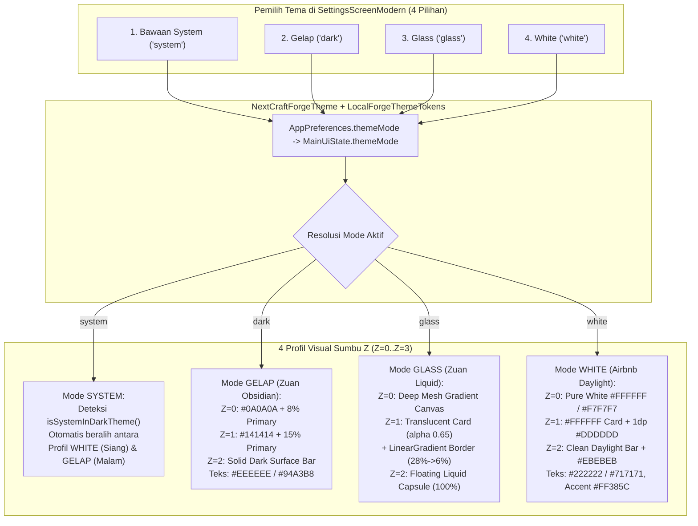

# NextCraft Forge — Arsitektur 100% Multi-Theme Engine (4 Mode: Bawaan System, Gelap, Glass, White)

> **Status Dokumen**: Cetak Biru Arsitektur Multi-Tema 100% (*4-Mode Theme Engine Blueprint — Siap Eksekusi*).
> **Empat Pilihan Mode Tema Resmi**:
> 1. **Bawaan System (`system`)** — Mengikuti tema aktif sistem operasi Android (`isSystemInDarkTheme()`) secara otomatis + dukungan palet adaptif.
> 2. **Gelap (`dark`)** — *Zuan Tinted Obsidian Dark*: Kanvas hitam pekat berdimensi (`#0A0A0A` + 8% Primary tint) dengan kartu Bento (`#141414` + 15% Primary tint) untuk kontras kode & terminal maksimal di malam hari.
> 3. **Glass (`glass`)** — *Zuan Liquid Glassmorphism*: Kanvas kosmik bergradasi dengan kartu kaca semi-transparan (`alpha = 0.68f`), garis tepi pantulan cahaya (*specular gradient border* `White 28% -> 6%`), dan kapsul navigasi melayang (`RoundedCornerShape(100)`).
> 4. **White (`white`)** — *Airbnb Daylight Pure White*: Kanvas putih murni (`#FFFFFF`) & permukaan sekunder (`#F7F7F7`), kartu putih dengan garis tepi tipis `1.dp` (`#DDDDDD`), tipografi tinta gelap (`#222222` & `#717171`), serta aksen *Airbnb Rausch* (`#FF385C`).

---

## 1. Diagram 3D Isometric: Transformasi 4 Mode Tema pada Sumbu Z (`Z=0` s/d `Z=3`)

Setiap halaman di **NextCraft Forge** menggunakan satu struktur komponen yang sama, namun seluruh permukaan, border, transparansi, dan navigasi pada sumbu **Z-Axis** berubah secara reaktif melalui `LocalForgeThemeTokens` sesuai pilihan pengguna:

```
====================================================================================================
                     ARSITEKTUR 3D MULTI-THEME ENGINE (4 PILIHAN TEMA)
====================================================================================================

  [1] BAWAAN SYSTEM (system)                  [2] GELAP / DARK (dark)
  +----------------------------------------+  +----------------------------------------+
  | Z=3 Modal : Auto (Putih / Obsidian)    |  | Z=3 Modal : #1C2330 + 1dp #2E3A4E      |
  | Z=2 Nav   : Auto Bar (Daylight / Dark) |  | Z=2 Nav   : #111827 Top & Bottom Bar   |
  | Z=1 Card  : Auto Surface + 1dp Border  |  | Z=1 Card  : #141414 + 15% Primary Tint |
  | Z=0 Canvas: isSystemInDarkTheme()      |  | Z=0 Canvas: #0A0A0A + 8% Primary Tint  |
  +----------------------------------------+  +----------------------------------------+

  [3] GLASS / LIQUID (glass)                  [4] WHITE / DAYLIGHT (white)
  +----------------------------------------+  +----------------------------------------+
  | Z=3 Modal : Frosted Glass (Alpha 0.78) |  | Z=3 Modal : #FFFFFF + Shadow 16dp      |
  | Z=2 Nav   : Liquid Capsule (Shape 100%)|  | Z=2 Nav   : #FFFFFF + 1dp #EBEBEB Line |
  | Z=1 Card  : Glass Alpha 0.65 + Specular|  | Z=1 Card  : #FFFFFF + 1dp #DDDDDD Line |
  | Z=0 Canvas: Radial Mesh Gradient       |  | Z=0 Canvas: #FFFFFF & #F7F7F7 Daylight |
  +----------------------------------------+  +----------------------------------------+
```

### Alur Reaktif 3D Multi-Theme Engine (Mermaid Architecture)



---

## 2. Matriks Token Lengkap untuk 4 Mode Tema (`ForgeThemeTokens`)

Berikut adalah spesifikasi nilai warna, transparansi, *border brush*, radius sudut, dan permukaan terminal/kode untuk masing-masing dari **4 pilihan tema**:

| Token / Lapisan 3D | 1. `SYSTEM` (Bawaan Sistem) | 2. `DARK` (Gelap — Zuan Obsidian) | 3. `GLASS` (Liquid Glassmorphism) | 4. `WHITE` (Airbnb Daylight White) |
| :--- | :--- | :--- | :--- | :--- |
| **Kode Preferensi (`themeMode`)** | `"system"` | `"dark"` | `"glass"` | `"white"` |
| **Deteksi Gelap/Terang** | `isSystemInDarkTheme()` | Selalu Gelap (`true`) | Berbasis Kosmik Transparan (`true`) | Selalu Terang/Putih (`false`) |
| **Z=0 Base Canvas (`background`)** | Mengikuti `WHITE` (Siang) / `DARK` (Malam) | `#0B0F17` (Obsidian + 8% Primary Tint) | Gradasi `#090D16` → `#111C2D` → `#0D1322` | `#FFFFFF` (Putih Murni 100%) |
| **Z=0 Secondary Canvas (`surfaceSubtle`)** | Mengikuti `WHITE` / `DARK` | `#111827` | `#141E30` (`alpha = 0.55f`) | `#F7F7F7` (Airbnb Warm Alabaster) |
| **Z=1 Card Surface (`cardBackground`)** | Mengikuti `WHITE` / `DARK` | `#161F30` (15% Primary di atas `#141414`) | `#1E293B` dengan `alpha = 0.62f` (Frosted) | `#FFFFFF` (Pure White Card) |
| **Z=1 Card Border (`cardBorder`)** | `1.dp` (`#DDDDDD` atau `#263248`) | `1.dp` Solid `#263248` | `0.8.dp` `LinearGradient(White 28% -> White 6%)` | `1.dp` Solid `#DDDDDD` (Hairline Airbnb) |
| **Z=1 Card Corner Radius** | `16.dp` | `20.dp` (Zuan Bento Squircle) | `24.dp` (Liquid Expressive) | `16.dp` (Airbnb Editorial Card) |
| **Z=1 Squircle Icon Box** | `primaryContainer` | `48.dp`, `RoundedCorner(14.dp)`, `primary(20%)` | `48.dp`, `RoundedCorner(16.dp)`, `White(12%)` | `44.dp`, `RoundedCorner(12.dp)`, `#FFF0F3` |
| **Warna Aksen Utama (`primary`)** | `#0284C7` (Siang) / `#38BDF8` (Malam) | `#38BDF8` (Forge Cyan) | `#60A5FA` (Liquid Electric Blue) | `#FF385C` (Airbnb Rausch Coral) |
| **Warna Aksen Sekunder (`secondary`)** | `#059669` (Siang) / `#34D399` (Malam) | `#34D399` (Emerald) | `#2DD4BF` (Liquid Mint Teal) | `#008489` (Airbnb Babu Teal) |
| **Teks Utama (`onBackground` / `onSurface`)** | `#111111` (Siang) / `#EEEEEE` (Malam) | `#EEEEEE` (Crisp Off-White) | `#F8FAFC` (Pure Ice White) | `#222222` (Airbnb Hof Charcoal) |
| **Teks Sekunder (`onSurfaceVariant`)** | `#666666` (Siang) / `#94A3B8` (Malam) | `#94A3B8` (Muted Slate) | `#CBD5E1` (Frosted Silver) | `#717171` (Airbnb Foggy Grey) |
| **Z=2 Navigation Bar Style** | Standar Bar sesuai OS | Solid Docked Bar (`#111827`) | **Floating Liquid Capsule** (`RoundedCorner(100)`, `H=76.dp`, `padding(horizontal=20.dp, bottom=20.dp)`) | Clean White Bar (`#FFFFFF` + `1.dp` top divider `#EBEBEB`) |
| **Z=1 Terminal & Code Surface** | `#F7F7F7` (Siang) / `#080B11` (Malam) | `#080B11` (Deep Terminal Black) | `#0A0F1D` dengan `alpha = 0.72f` + Border Kaca | `#F7F7F7` dengan Border `#E5E5E5` & Teks `#222222` |
| **Diff Added Row (`+`)** | Hijau Adaptif | Bg `#063626`, Teks `#6EE7B7` | Bg `#064E3B` (`alpha 0.45f`), Teks `#A7F3D0` | Bg `#EAFBF0`, Teks `#006338` |
| **Diff Removed Row (`-`)** | Merah Adaptif | Bg `#450A0A`, Teks `#FCA5A5` | Bg `#7F1D1D` (`alpha 0.45f`), Teks `#FECACA` | Bg `#FFF0F0`, Teks `#C13515` |

---

## 3. Bedah Anatomi Visual Tiap Pilihan Tema

### Pilihan 1: **Bawaan System (`system`)**
- **Perilaku**: Membaca `isSystemInDarkTheme()` secara langsung dari sistem operasi Android.
- **Saat Android dalam Mode Terang**: Memakai palet permukaan terang yang bersih dengan kontras teks `#0F172A` di atas `#F8FAFC` dan kartu `#FFFFFF`.
- **Saat Android dalam Mode Gelap**: Otomatis beralih ke palet gelap (`#0B0F17` & `#111827`) tanpa perlu di-restart.
- **Cocok Untuk**: Pengguna yang ingin NextCraft Forge menyatu secara otomatis dengan jadwal *Dark Mode* siang/malam di ponsel mereka.

### Pilihan 2: **Gelap (`dark`) — Zuan Obsidian Dark**
- **Perilaku**: Mengunci aplikasi pada mode gelap berdimensi tinggi yang terinspirasi dari **Zuan Kernel Manager Dark Mode**.
- **Struktur 3D**:
  - Kanvas dasar (`Z=0`): `#0B0F17` (campuran `#0A0A0A` dengan 8% *primary tint*).
  - Kartu (`Z=1`): `#161F30` (campuran `#141414` dengan 15% *primary tint*) + garis tepi `1.dp` `#263248`.
  - Kontras teks `#EEEEEE` dan `#94A3B8` yang tidak membuat mata cepat lelah saat membaca ribuan baris log terminal atau kode Kotlin.

### Pilihan 3: **Glass (`glass`) — Zuan Liquid Glassmorphism**
- **Perilaku**: Mengaktifkan estetika **Liquid Glass** dari `LiquidNavigationBar.kt` milik Zuan Kernel Manager di seluruh lapisan aplikasi:
  - **Kanvas (`Z=0`)**: Latar belakang gradasi multi-titik (`Brush.verticalGradient` / `radialGradient` dari `#090D16`, `#132038`, hingga `#0B111E`) sehingga elemen transparan di atasnya memiliki kedalaman optik nyata.
  - **Kartu Kaca (`Z=1`)**: Permukaan semi-transparan (`Color(0xFF1E293B).copy(alpha = 0.62f)`) yang dibingkai oleh **Specular Gradient Border** (`0.8.dp`, `Brush.linearGradient(listOf(Color.White.copy(alpha = 0.28f), Color.White.copy(alpha = 0.06f)))`).
  - **Floating Liquid Navigation Capsule (`Z=2`)**: Bilah navigasi bawah tidak menempel kaku di tepi layar, melainkan melayang berbentuk kapsul penuh (`RoundedCornerShape(100)`) dengan margin kiri-kanan `20.dp`, margin bawah `16.dp`, latar kaca `alpha = 0.78f`, dan indikator tab berbentuk pil bercahaya.

### Pilihan 4: **White (`white`) — Airbnb Daylight Pure White**
- **Perilaku**: Mengaktifkan estetika **Airbnb Daylight DLS 100% Putih Bersih**:
  - **Kanvas (`Z=0`)**: Putih murni `#FFFFFF` dengan area pengelompokan sekunder `#F7F7F7`.
  - **Kartu (`Z=1`)**: Putih `#FFFFFF` dengan garis tepi tipis `1.dp` `#DDDDDD` (*hairline border*) dan sudut `16.dp`.
  - **Tipografi & Aksen**: Teks utama `#222222` (*Airbnb Hof*), teks sekunder `#717171` (*Airbnb Foggy*), aksen utama `#FF385C` (*Airbnb Rausch*), dan status sukses `#008A05`.
  - **Terminal & Editor Kode**: Menggunakan permukaan terang `#F7F7F7` dengan teks monospasi gelap `#222222` (bebas kotak hitam pekat).

---

## 4. Desain Komponen Pemilih 4 Tema di `SettingsScreenModern.kt`

Pada bagian **Security, Language & Appearance** di `SettingsScreenModern.kt`, tombol tunggal *"Switch Theme"* digantikan oleh **4 Kartu/Chip Pemilih Tema Visual (2×2 Bento Grid atau 4-Pill Row)** yang menampilkan pratinjau mini setiap tema:

```
+-----------------------------------------------------------------------+
|  Appearance & Theme Mode                                              |
|  Pilih gaya visual antarmuka NextCraft Forge:                         |
|                                                                       |
|  +-------------------------------+   +-----------------------------+  |
|  | [📱] Bawaan System            |   | [🌙] Gelap (Dark)           |  |
|  |      Ikuti mode siang/malam   |   |      Obsidian kontras tinggi|  |
|  |      otomatis dari Android    |   |      untuk coding malam     |  |
|  +-------------------------------+   +-----------------------------+  |
|  +-------------------------------+   +-----------------------------+  |
|  | [✨] Glass (Liquid)           |   | [☀️] White (Daylight)       |  |
|  |      Kaca transparan & kapsul |   |      Putih bersih bergaya   |  |
|  |      navigasi melayang 3D     |   |      editorial Airbnb       |  |
|  +-------------------------------+   +-----------------------------+  |
+-----------------------------------------------------------------------+
```

---

## 5. Peta Integrasi Kode Sumber (Tanpa Mengubah Logika Bisnis Blok 1–4)

Ketika arsitektur 4-Tema ini dieksekusi ke kode sumber, perubahan hanya menyentuh lapisan **Tema, Preferensi, dan Komponen UI (Blok 5 & 6)**:

1. **`app/src/main/java/com/nextcraft/forge/ui/Theme.kt`**:
   - Menambahkan `enum class ForgeThemeMode(val id: String, val title: String, val subtitle: String)` dengan 4 entri: `SYSTEM("system")`, `DARK("dark")`, `GLASS("glass")`, `WHITE("white")`.
   - Menambahkan `data class ForgeThemeTokens` dan `LocalForgeThemeTokens` (`CompositionLocal`) yang menyediakan warna kanvas, *card surface*, *card border brush*, *corner radius*, warna diff (`+`/`-`), warna terminal, serta flag `isGlass` dan `isWhite`.
   - Memperbarui `NextCraftForgeTheme(themeMode: String)` agar menyuplai `MaterialTheme` + `LocalForgeThemeTokens` untuk keempat mode.
2. **`app/src/main/java/com/nextcraft/forge/ui/MainViewModel.kt`**:
   - Menambahkan `fun setThemeMode(mode: String)` (mendukung `"system"`, `"dark"`, `"glass"`, `"white"`) dan memperbarui `fun toggleThemeMode()` agar berputar melewati 4 mode (`system -> dark -> glass -> white`).
3. **`app/src/main/java/com/nextcraft/forge/ui/NextCraftForgeApp.kt`**:
   - Membungkus `Scaffold` dengan latar kanvas `ForgeThemeTokens` (termasuk *radial/vertical mesh gradient* saat mode `GLASS` dan putih murni `#FFFFFF` saat mode `WHITE`).
   - Merender **Floating Liquid Capsule Navigation Bar (`RoundedCornerShape(100)`)** saat mode `GLASS` aktif, dan bilah navigasi bersih ber-divider `#EBEBEB` saat mode `WHITE` aktif.
4. **`app/src/main/java/com/nextcraft/forge/ui/SettingsScreenModern.kt`**:
   - Menampilkan pemilih 4 mode tema (`Bawaan System`, `Gelap`, `Glass`, `White`) yang langsung mengubah tampilan seluruh aplikasi secara *real-time* tanpa perlu me-restart aktivitas.
5. **`AgentScreen.kt`, `FilesAndDiffScreen.kt`, `TerminalScreen.kt`, `AndroidAndPreviewScreen.kt`**:
   - Mengganti warna permukaan terminal/diff/kartu yang sebelumnya *hardcoded* dengan token adaptif dari `LocalForgeThemeTokens.current` sehingga keempat mode (`System`, `Gelap`, `Glass`, `White`) tampil 100% konsisten di seluruh 7 layar.
