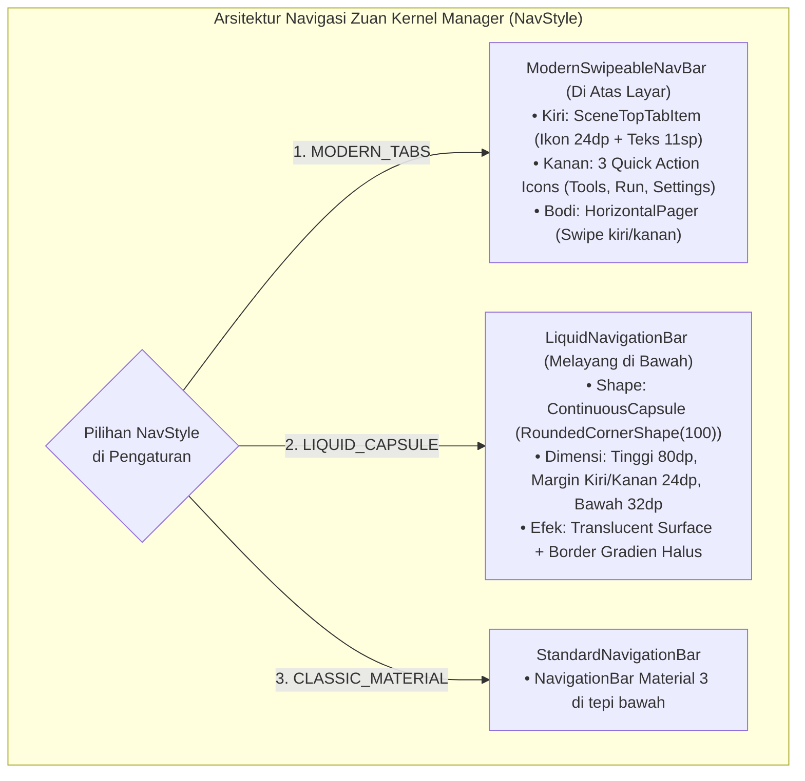

# BEDAH STRUKTUR ARSITEKTUR UI/UX 100% — ZUAN KERNEL MANAGER (`ZUANVFX01/ZKM`) & PEMETAAN KE NEXTCRAFT FORGE

> **Status Dokumen**: Bedah Arsitektur Lengkap 100% (Berdasarkan Audit Kode Sumber Asli `github.com/ZUANVFX01/ZKM` — **Belum Dieksekusi ke Kode Sumber Aplikasi**)
> **Referensi Desain Utama**: **Zuan Kernel Manager (ZKM) — *Material 3 Expressive + Soft Primary-Tinted Surface + Liquid Capsule Glass***
> **File Sumber ZKM yang Dianalisis**:
> - `ui/theme/Theme.kt`, `Color.kt`, `ThemeMode.kt`, `Type.kt`
> - `ui/settings/SettingsPreference.kt`, `SettingsViewModel.kt`, `WallpaperStyleViewModel.kt`, `SettingsComponents.kt`, `SettingsScreen.kt`
> - `ui/navigation/LiquidNavigationBar.kt`, `ModernTabNavigationBar.kt`, `MainSwipeScreen.kt`, `NavigationRoute.kt`
> - `ui/home/HomeScreen.kt`, `ui/overall/OverallScreen.kt`, `ui/soc/SoCScreen.kt`, `ui/logsview/LogsViewScreen.kt`

---

## DAFTAR ISI
1. [Filosofi & Struktur Inti UI/UX Zuan Kernel Manager (ZKM)](#1-filosofi--struktur-inti-uiux-zuan-kernel-manager-zkm)
2. [Diagram Perspektif 3D — 4 Bidang Lapisan ZKM (3-Axis Isometric Stack)](#2-diagram-perspektif-3d--4-bidang-lapisan-zkm-3-axis-isometric-stack)
3. [Bedah Rumus Matematika Warna & 24 Preset Palet ZKM (`SettingsPreference.kt`)](#3-bedah-rumus-matematika-warna--24-preset-palet-zkm-settingspreferencekt)
4. [Bedah Struktur Navigasi Ganda ZKM (`ModernTabNavigationBar` & `LiquidNavigationBar`)](#4-bedah-struktur-navigasi-ganda-zkm-moderntabnavigationbar--liquidnavigationbar)
5. [Bedah Anatomi Kartu & Grid ZKM (`ExpressiveGlassCard`, `CompactFeatureCard`, `Bento FlowRow`)](#5-bedah-anatomi-kartu--grid-zkm-expressiveglasscard-compactfeaturecard-bento-flowrow)
6. [Blueprint 3D & Wireframe Presisi Piksel: Penerapan Struktur ZKM ke 7 Layar NextCraft Forge](#6-blueprint-3d--wireframe-presisi-piksel-penerapan-struktur-zkm-ke-7-layar-nextcraft-forge)
   - [6.1. Layar 0 — ZKM Expressive Setup & Root Verification (`NextCraftForgeApp.kt`)](#61-layar-0--zkm-expressive-setup--root-verification-nextcraftforgeappkt)
   - [6.2. Layar 1 — Global Shell: Collapsible Haze TopBar, Scene Tabs & Liquid Capsule Dock (`NextCraftForgeApp.kt`)](#62-layar-1--global-shell-collapsible-haze-topbar-scene-tabs--liquid-capsule-dock-nextcraftforgeappkt)
   - [6.3. Layar 2 — Studio: Expressive Chat Cards, Squircle Tool Chips & Floating Capsule Composer (`AgentScreen.kt`)](#63-layar-2--studio-expressive-chat-cards-squircle-tool-chips--floating-capsule-composer-agentscreenkt)
   - [6.4. Layar 3 — Code: Bento File Cards, Pinned Gutter Editor & Tinted Diff Cards (`FilesAndDiffScreen.kt`)](#64-layar-3--code-bento-file-cards-pinned-gutter-editor--tinted-diff-cards-filesanddiffscreenkt)
   - [6.5. Layar 4 — Console: ZKM LogsView-Style Terminal & Quick Pill Strip (`TerminalScreen.kt`)](#65-layar-4--console-zkm-logsview-style-terminal--quick-pill-strip-terminalscreenkt)
   - [6.6. Layar 5 — Launch: ZKM Dashboard-Style APK Builder, Wavy Progress & Logcat (`AndroidAndPreviewScreen.kt`)](#66-layar-5--launch-zkm-dashboard-style-apk-builder-wavy-progress--logcat-androidandpreviewscreenkt)
   - [6.7. Layar 6 — Settings & Theme Studio: 24 Preset Warna, NavStyle & Bento Category Grid (`SettingsScreenModern.kt`)](#67-layar-6--settings--theme-studio-24-preset-warna-navstyle--bento-category-grid-settingsscreenmodernkt)
7. [Matriks Perbandingan Langsung: Struktur Airbnb DLS vs Struktur Zuan Kernel Manager (ZKM)](#7-matriks-perbandingan-langsung-struktur-airbnb-dls-vs-struktur-zuan-kernel-manager-zkm)

---

## 1. Filosofi & Struktur Inti UI/UX Zuan Kernel Manager (ZKM)

Hasil audit kode sumber `ZUANVFX01/ZKM` menunjukkan bahwa UI Zuan Kernel Manager dibangun di atas **5 pilar struktural**:

1. **Kanvas Ber-Tint Dinamis (*3% Primary-Tinted Light Canvas* / *8% Primary-Tinted Dark Canvas*)**:
   - Di setiap layar (`HomeScreen.kt`, `OverallScreen.kt`, `LogsViewScreen.kt`, `ModernTabNavigationBar.kt`), ZKM tidak pernah menggunakan abu-abu mati. Latar belakang selalu dihitung secara matematis dari warna `Primary` aktif sehingga seluruh layar memiliki "aura" warna tema yang lembut.
2. **Geometri *Material 3 Expressive* (Sudut Ekstra Bulat & Squircle Bersarang)**:
   - Kartu Hero memakai `RoundedCornerShape(28.dp)`.
   - Kartu Fitur memakai `RoundedCornerShape(20.dp)`.
   - Wadah ikon di dalam kartu (*Squircle Icon Box*) memakai `RoundedCornerShape(14.dp)` berukuran `48.dp × 48.dp` dengan latar `primaryContainer.copy(alpha = 0.7f)`.
3. **Tata Letak *Bento Grid 2-Kolom* dengan Header Kategori Kapital (`UPPERCASE`)**:
   - Alih-alih menampilkan daftar panjang satu kolom, ZKM mengelompokkan fitur berdasarkan kategori (`SYSTEM`, `MONITOR`, `ROOT`) dengan teks `labelMedium` (`FontWeight.Bold`, `letterSpacing = 1.sp`), lalu menyusun kartu dalam **Grid 2 Kolom (`FlowRow` `maxItemsInEachRow = 2`, `spacedBy(12.dp)`)**.
4. **Arsitektur Navigasi Fleksibel (`SceneTopTabItem` + `HorizontalPager` + `LiquidNavigationBar`)**:
   - Bagian atas memiliki *Translucent Top Bar* (`blurRadius = 24.dp`, `alpha = 0.5f`) yang menggabungkan tab halaman (`SceneTopTabItem` dengan animasi warna `tween(300)`) di sisi kiri dan **3 Ikon Aksi Cepat** (`Equalizer/Tools`, `Power`, `Settings`) di sisi kanan.
   - Bagian bawah mendukung **Floating Liquid Capsule Bar** (`ContinuousCapsule = RoundedCornerShape(100)`, `height = 80.dp`, mengambang `32.dp` dari tepi bawah dan `24.dp` dari kiri/kanan).
5. **Interaksi Pegas (*Spring Physics*) & Umpan Balik Haptik (`LocalHapticFeedback`)**:
   - Semua transisi scroll dan tekan kartu menggunakan fisika pegas (`spring(stiffness = Spring.StiffnessMediumLow)`) sehingga kartu membal secara organik saat disentuh.

---

## 2. Diagram Perspektif 3D — 4 Bidang Lapisan ZKM (3-Axis Isometric Stack)

Di dalam kode ZKM (`HomeScreen.kt` & `LogsViewScreen.kt`), setiap layar dirender sebagai `Box(Modifier.fillMaxSize())` yang menumpuk **4 lapisan Z-Index**:

- **Bidang Z3 (Top & Bottom Translucent Chrome — `zIndex = 2f`)**:
  - Atas: `LargeTopAppBar` / `ModernSwipeableNavBar` dengan efek kaca transparan (`tintedBackground.copy(alpha = 0.85f)`), menampilkan *Scene Tabs* di kiri + *Quick Action Icons* di kanan.
  - Bawah: `LiquidNavigationBar` berbentuk kapsul penuh (`RoundedCornerShape(100)`) yang melayang di atas konten.
- **Bidang Z2 (Expressive Bento Cards & Squircle Containers — `zIndex = 1f`)**:
  - Kartu Hero (`28.dp`) dan Grid Bento 2-Kolom (`20.dp`).
  - Pada Light Mode: Kartu berwarna **Putih Murni (`#FFFFFF`)**; pada Dark Mode: Kartu berwarna **`(Primary × 0.15) compositeOver #141414`**.
  - Bila mode *Glass* aktif, kartu memiliki border gradien diagonal `Brush.linearGradient(White 25% -> White 5%)`.
- **Bidang Z1 (Scrollable Content Container dengan `nestedScrollConnection`)**:
  - Mengatur *collapse/expand* otomatis pada header saat pengguna menggulir layar (`collapsedFraction`).
- **Bidang Z0 (Soft Primary-Tinted Base Canvas — `zIndex = 0f`)**:
  - Kanvas dasar berformula `97% White + 3% Primary` (Light) atau `(Primary × 0.08) compositeOver #0A0A0A` (Dark).

```text
====================================================================================
     PERSPEKTIF 3D ISOMETRIK — STRUKTUR 4 LAPISAN ZUAN KERNEL MANAGER (ZKM)
====================================================================================

   [ BIDANG Z3: TRANSLUCENT SCENE TOP BAR & FLOATING LIQUID CAPSULE DOCK ]
      ╭─────────────────────────────────────────────────────────────────╮
     /  ◉ Studio   ○ Code   ○ Console   ○ Launch        [🛠️] [⚡] [⚙️] /| <-- SceneTopTabItem
    /   (Kiri: Ikon 24dp di atas Label 11sp Bold | Kanan: Quick Icons) / |     + Quick Actions
   +------------------------------------------------------------------+  |
   |                                                                  |  |
   |                  (Area Scroll Konten Tengah)                     |  |
   |                                                                  |  |
   +------------------------------------------------------------------+  |
    \       ╭──────────────────────────────────────────────────╮       \ | <-- LiquidNavigationBar
     \      │   ◉ Studio    ○ Code    ○ Console    ○ Launch    │        \|     (Radius 100% Capsule,
      \     ╰──────────────────────────────────────────────────╯         \      Padding Bottom 32dp)
       +------------------------------------------------------------------+
                                        │
                                        ▼
   [ BIDANG Z2: EXPRESSIVE HERO CARD (28.dp) & 2-COLUMN BENTO GRID (20.dp) ]
        ╭─────────────────────────────────────────────────────────────╮
       /  ╭────────╮  Forge Notes Android                             /| <-- Hero Card (28.dp)
      /   │ 🤖 48dp│  Claude Code · Sonnet 4.6 · /workspace/notes    / |     + Squircle 14.dp
     /    ╰────────╯  [ ● Root Chroot Ready ]    [ +3 Files Diff ]  /  |
    +--------------------------------------------------------------+   |
    |  WORKSPACE & AI TOOLS (11.sp Bold, LetterSpacing 1.sp)       |   | <-- Category Header
    |  ╭───────────────────────────╮  ╭───────────────────────────╮|   |
    |  │ ╭──────╮  Build Debug APK │  │ ╭──────╮  Review Diff     │|   | <-- 2-Column Bento Grid
    |  │ │  📦  │  assembleDebug   │  │ │  ✨  │  3 files changed │|   /     (FlowRow 2 kolom,
    |  │ ╰──────╯                  │  │ ╰──────╯                  │|  /       Gap 12.dp, Radius 20.dp)
    |  ╰───────────────────────────╯  ╰───────────────────────────╯| /
    +--------------------------------------------------------------+/
                                        │
                                        ▼
   [ BIDANG Z0: DYNAMIC TINTED BASE CANVAS (generateThemedBackgroundColor) ]
    +-----------------------------------------------------------------+
   /  LIGHT MODE : Color(0.97 + R*0.03, 0.97 + G*0.03, 0.97 + B*0.03) /
  /   DARK MODE  : Primary.copy(R*0.08, G*0.08, B*0.08) over #0A0A0A /
 +------------------------------------------------------------------+
```

---

## 3. Bedah Rumus Matematika Warna & 24 Preset Palet ZKM (`SettingsPreference.kt`)

### 3.1. Algoritma Pewarnaan Permukaan Dinamis ZKM
Di dalam kode ZKM (`HomeScreen.kt` baris 66–99 & `LogsViewScreen.kt` baris 103–139), warna latar dan kartu **tidak di-hardcode**, melainkan diturunkan secara otomatis dari `primaryColor` yang dipilih pengguna:

```kotlin
fun generateZuanThemedColors(primaryColor: Color, isDark: Boolean): Pair<Color, Color> {
    return if (isDark) {
        // Dark Mode: 8% Primary di-blend di atas #0A0A0A
        val darkTintedBg = primaryColor.copy(
            red = primaryColor.red * 0.08f,
            green = primaryColor.green * 0.08f,
            blue = primaryColor.blue * 0.08f,
            alpha = 1f,
        ).compositeOver(Color(0xFF0A0A0A))

        // Dark Card: 15% Primary di-blend di atas #141414
        val darkCardColor = primaryColor.copy(
            red = primaryColor.red * 0.15f,
            green = primaryColor.green * 0.15f,
            blue = primaryColor.blue * 0.15f,
            alpha = 1f,
        ).compositeOver(Color(0xFF141414))

        darkTintedBg to darkCardColor
    } else {
        // Light Mode: 97% Putih + 3% Primary -> Latar pastel super lembut
        val softLightBg = Color(
            red = 0.97f + (primaryColor.red * 0.03f),
            green = 0.97f + (primaryColor.green * 0.03f),
            blue = 0.97f + (primaryColor.blue * 0.03f),
            alpha = 1f,
        )
        // Light Card: Putih bersih 100% (#FFFFFF) sehingga kontras timbul di atas softLightBg
        val lightCardColor = Color(0xFFFFFFFF)

        softLightBg to lightCardColor
    }
}
```

### 3.2. Tabel 24 Preset Warna Asli ZKM (`availableColors` di `SettingsPreference.kt`)

| No | Nama Preset ZKM | Primary Hex | Secondary Hex | Tertiary Hex | Hasil Kanvas Light Mode (`97% White + 3% Primary`) |
| :-: | :--- | :---: | :---: | :---: | :---: |
| 1 | **Blue (Default ZKM)** | `#4A6595` | `#586275` | `#5E4B8B` | `#F8F9FC` (Ice Blue Alabaster) |
| 2 | **Green** | `#556B2F` | `#4F6A55` | `#356A4F` | `#F9FAF8` (Sage Mist) |
| 3 | **Purple** | `#7B52AB` | `#685675` | `#8B4C70` | `#FAF8FC` (Lavender Silk) |
| 4 | **Orange** | `#B36B36` | `#8B6B55` | `#9C551F` | `#FCF9F8` (Warm Terracotta Tint) |
| 5 | **Pink** | `#BC4C73` | `#9C4C66` | `#8B4C66` | `#FCF8FA` (Blush Quartz) |
| 6 | **Gray** | `#6B6B6B` | `#555555` | `#3E3E3E` | `#FAFAFA` (Neutral Platinum) |
| 7 | **Yellow** | `#9C8B1F` | `#7B6B1F` | `#6B551F` | `#FBFAF7` (Warm Ivory) |
| 8 | **Light Green** | `#7CB342` | `#689F38` | `#558B2F` | `#F9FBF8` (Spring Leaf Tint) |
| 9 | **Dark Green** | `#1B5E20` | `#2E7D32` | `#388E3C` | `#F7FAF7` (Forest Dew) |
| 10 | **Teal** | `#00897B` | `#00796B` | `#00695C` | `#F7FAFA` (Aqua Porcelain) |
| 11 | **Cyan** | `#00ACC1` | `#0097A7` | `#00838F` | `#F7FBFC` (Glacier Tint) |
| 12 | **Light Blue** | `#29B6F6` | `#03A9F4` | `#0288D1` | `#F8FCFF` (Sky Alabaster) |
| 13 | **Indigo** | `#5C6BC0` | `#3F51B5` | `#3949AB` | `#F9F9FD` (Indigo Frost) |
| 14 | **Deep Purple** | `#7E57C2` | `#673AB7` | `#5E35B1` | `#FAF8FD` (Amethyst Snow) |
| 15 | **Magenta** | `#D81B60` | `#C2185B` | `#AD1457` | `#FDF7F9` (Ruby Silk) |
| 16 | **Rose** | `#F06292` | `#EC407A` | `#E91E63` | `#FEF9FB` (Rose Petal) |
| 17 | **Coral** | `#FF7043` | `#FF5722` | `#F4511E` | `#FFF9F8` (Coral Sunset Tint) |
| 18 | **Amber** | `#FFB300` | `#FFA000` | `#FF8F00` | `#FFFBF7` (Amber Cream) |
| 19 | **Lime** | `#AFB42B` | `#9E9D24` | `#827717` | `#FBFBF7` (Citrus Mist) |
| 20 | **Mint** | `#26A69A` | `#4DB6AC` | `#80CBC4` | `#F8FBFB` (Mint Alabaster) |
| 21 | **Navy** | `#1A237E` | `#283593` | `#303F9F` | `#F7F8FA` (Midnight Tint) |
| 22 | **Slate** | `#455A64` | `#546E7A` | `#607D8B` | `#F8F9FA` (Nordic Slate) |
| 23 | **Charcoal** | `#37474F` | `#455A64` | `#263238` | `#F8F9F9` (Graphite Snow) |
| 24 | **Burgundy** | `#880E4F` | `#AD1457` | `#C2185B` | `#FAF7F9` (Wine Velvet Tint) |
| 25 | **Peach** | `#FFAB91` | `#FF8A65` | `#FF7043` | `#FFFBF9` (Warm Peach) |

### 3.3. Warna Teks Standar ZKM (`HomeScreen.kt` baris 161–162)
- **Light Mode**:
  - `customOnSurface` (Teks Utama): **`#111111`** (Hitam pekat tajam, kontras **18.9 : 1** di atas `#FFFFFF`).
  - `customOnSurfaceVariant` (Teks Subjudul/Kategori): **`#666666`** (Kontras **5.7 : 1**).
- **Dark Mode**:
  - `customOnSurface`: **`#EEEEEE`**
  - `customOnSurfaceVariant`: **`#AAAAAA`**

---

## 4. Bedah Struktur Navigasi Ganda ZKM (`ModernTabNavigationBar` & `LiquidNavigationBar`)



### Anatomi `SceneTopTabItem` (Bar Navigasi Atas ZKM)
```text
Padding luar: horizontal = 20.dp, vertical = 12.dp
+--------------------------------------------------------------------+
|  [ ✦ ]      [ 📁 ]      [ >_ ]      [ 📱 ]         🛠️    ⚡    ⚙️   |
|  Studio      Code       Console     Launch                         |
| (Accent)   (#666666)   (#666666)   (#666666)     (Quick Actions)   |
+--------------------------------------------------------------------+
  ▲─────────── Jarak antar-tab: 15.dp ───────────▲  ▲── Jarak 20.dp ─▲
```
- Setiap item tab di kiri adalah `Column(horizontalAlignment = CenterHorizontally)`:
  - `Icon` ukuran `24.dp` (berubah warna secara halus menggunakan `animateColorAsState(tween(300))`).
  - `Spacer(height = 3.dp)`
  - `Text` ukuran `11.sp`, `FontWeight.Bold` saat aktif dan `FontWeight.Medium` saat tidak aktif.
- Di sebelah kanan adalah 3 ikon tindakan cepat (`24.dp`) untuk membuka dialog *Quick Tools*, *Workspace Switcher*, dan halaman *Settings*.

### Anatomi `LiquidNavigationBar` (Kapsul Melayang Bawah ZKM)
```text
Margin: start = 24.dp, end = 24.dp, bottom = 32.dp | Tinggi: 68.dp–76.dp
Shape: ContinuousCapsule = RoundedCornerShape(100)
╭────────────────────────────────────────────────────────────────────╮
│     ╭──────────────╮                                               │
│     │   ✦ Studio   │       📁 Code       >_ Console     📱 Launch  │
│     ╰──────────────╯                                               │
╰────────────────────────────────────────────────────────────────────╯
```
- Tidak menempel kaku ke tepi kiri/kanan/bawah layar, melainkan mengambang seperti kapsul kaca di atas daftar konten yang sedang di-scroll.

---

## 5. Bedah Anatomi Kartu & Grid ZKM (`ExpressiveGlassCard`, `CompactFeatureCard`, `Bento FlowRow`)

Di dalam `HomeScreen.kt` dan `OverallScreen.kt`, ZKM memiliki **3 komponen kartu utama**:

### 5.1. `DeviceInfoCompact` / Hero Status Card (`RoundedCornerShape(20.dp–28.dp)`)
```text
╭────────────────────────────────────────────────────────────────────╮
│  ╭──────────╮  Forge Notes (/workspace/forge-notes)                │
│  │  🤖 48dp │  Claude Code • Sonnet 4.6 • Ubuntu 24.04 ARM64       │
│  │  Rad 14dp│  ● Chroot Ready  •  3 Files Modified                 │
│  ╰──────────╯                                                      │
╰────────────────────────────────────────────────────────────────────╯
```
- **Wadah Ikon Kiri (`Surface`)**: Ukuran `48.dp`, `shape = RoundedCornerShape(14.dp)`, warna `MaterialTheme.colorScheme.primaryContainer.copy(alpha = 0.7f)`, ikon `28.dp` di tengah dengan `tint = onPrimaryContainer`.
- **Kolom Informasi Kanan**: Judul `titleMedium Bold` (`#111111`), baris detail `bodySmall` (`#666666`), dan chip status kecil.

### 5.2. `CompactFeatureCard` dalam *2-Column Bento Grid* (`FlowRow maxItemsInEachRow = 2`)
```text
CATEGORY HEADER (11.sp Bold, Uppercase, letterSpacing = 1.sp, #666666)
╭───────────────────────────────╮  ╭───────────────────────────────╮
│  ╭────────╮                   │  │  ╭────────╮                   │
│  │ ⚡ 40dp│  Execute Prompt   │  │  │ 📦 40dp│  Build Debug APK  │
│  │ Rad12dp│  Run AI Agent     │  │  │ Rad12dp│  Gradle ARM64     │
│  ╰────────╯                   │  │  ╰────────╯                   │
╰───────────────────────────────╯  ╰───────────────────────────────╯
   Modifier.weight(1f)                Modifier.weight(1f)
   Gap horizontal = 12.dp, Gap vertikal = 12.dp
```
- Jika jumlah item dalam suatu kategori ganjil (`items.size % 2 != 0`), ZKM menambahkan `Spacer(Modifier.weight(1f))` di kolom kanan agar lebar kartu terakhir tetap 50% (tidak melar sendirian menjadi 100%).

---

## 6. Blueprint 3D & Wireframe Presisi Piksel: Penerapan Struktur ZKM ke 7 Layar NextCraft Forge

Berikut adalah bagaimana **struktur murni Zuan Kernel Manager (ZKM)** diterapkan secara presisi ke seluruh 7 layar **NextCraft Forge**:

---

### 6.1. Layar 0 — *ZKM Expressive Setup & Root Verification* (`NextCraftForgeApp.kt`)
- Menggunakan kanvas ber-tint lembut `generateZuanThemedColors(primary, isDark)`.
- Bagian atas menampilkan **Hero Device & Root Card (`28.dp`)** persis seperti `OverallScreen.kt` di ZKM: mendeteksi status `su -mm`, arsitektur `arm64-v8a`, dan status mount rootfs.
- Keempat bundle runtime (`Core`, `Claude`, `Antigravity`, `DSH`) disusun dalam **2×2 Bento Grid (`FlowRow maxItemsInEachRow = 2`)** dengan *Squircle Icon* `48.dp` dan indikator progres melingkar/linear.

```text
+====================================================================+
|  NEXTCRAFT FORGE                                    [ Skip Setup ] |
|  Zuan Expressive Edition · Root Chroot Studio                      |
|                                                                    |
|  ╭──────────────────────────────────────────────────────────────╮  |
|  │  ╭────────╮  ARM64 Root Chroot Engine                        │  |
|  │  │ 🛡️ 48dp│  su -mm Namespace: Granted • Ubuntu 24.04.5 LTS  │  |
|  │  ╰────────╯  [ Re-check Root ]          [ Repair Rootfs ]    │  |
|  ╰──────────────────────────────────────────────────────────────╯  |
|                                                                    |
|  RUNTIME BUNDLES (.TAR.ZST)                                        |
|  ╭─────────────────────────────╮  ╭─────────────────────────────╮  |
|  │ ╭──────╮  Core Rootfs       │  │ ╭──────╮  Claude Code       │  |
|  │ │  🐧  │  Ubuntu 24 + Node  │  │ │  🤖  │  Official ARM64    │  |
|  │ ╰──────╯  [ ● Installed ]   │  │ ╰──────╯  [ ● Installed ]   │  |
|  ╰─────────────────────────────╯  ╰─────────────────────────────╯  |
|  ╭─────────────────────────────╮  ╭─────────────────────────────╮  |
|  │ ╭──────╮  Antigravity CLI   │  │ ╭──────╮  DeepSeek DSH      │  |
|  │ │  🚀  │  Google AI Agent   │  │ │  🧠  │  Harness CLI       │  |
|  │ ╰──────╯  [ ● Installed ]   │  │ ╰──────╯  [ ○ Optional  ]   │  |
|  ╰─────────────────────────────╯  ╰─────────────────────────────╯  |
|                                                                    |
|  ╭──────────────────────────────────────────────────────────────╮  |
|  │  [ Import Local .tar.zst ]      [ Install Recommended ↗ ]    │  |
|  ╰──────────────────────────────────────────────────────────────╯  |
+====================================================================+
```

---

### 6.2. Layar 1 — *Global Shell: Scene TopBar, Quick Dialogs & Liquid Capsule Dock* (`NextCraftForgeApp.kt`)
Mengadopsi struktur `MainSwipeScreen.kt` + `ModernTabNavigationBar.kt` + `LiquidNavigationBar.kt` dari ZKM:
- **Header Atas (`ZuanSceneTopBar`)**:
  - Kiri: Pemilih Proyek & Status Chroot dengan *Squircle Badge* `40.dp` yang membuka **Workspace & Agent Dialog (`DialogUnstyled` ala ZKM)** saat diketuk.
  - Kanan: 3 Ikon Aksi Cepat khas ZKM:
    1. `➕` (*New Project / New Chat Dialog*)
    2. `🎨` (*Quick Theme & Palette Switcher*: ganti Light/Dark atau pilih dari 24 warna ZKM secara instan!)
    3. `⚙️` (*Buka Settings / Host Screen*)
- **Navigasi Utama**: Mendukung perpindahan mulus antar-layar (`Studio`, `Code`, `Console`, `Launch`, `Settings`) menggunakan **Floating Liquid Capsule Bar** di bawah (atau *Scene Top Tabs*).

---

### 6.3. Layar 2 — *Studio: Expressive Chat Cards, Squircle Tool Chips & Floating Capsule Composer* (`AgentScreen.kt`)
- **Bagian Atas**: Kartu ringkas `WorkspaceActiveCompactCard` (`20.dp`) dengan *Squircle Icon* agen yang aktif (`Claude` / `Antigravity` / `DeepSeek`), pemilih cepat agen & tab chat.
- **Ketika Sesi Kosong (*Empty State*)**:
  - Menampilkan kategori `QUICK ACTIONS` dengan **2×2 Bento Grid (`CompactFeatureCard`)**:
    1. `✨ Scaffold UI` | 2. `🐞 Fix Build Errors`
    3. `🔍 Explain Code` | 4. `🚀 Git Sync & Push`
- **Kartu Pesan & Tool**:
  - Pesan asisten menggunakan `ExpressiveGlassCard` (`RoundedCornerShape(22.dp)`, latar `#FFFFFF` di atas kanvas *3% Primary Tint*) dengan *Squircle Avatar* `36.dp` di pojok kiri atas.
  - Aktivitas tool ditampilkan sebagai kapsul berbingkai `primaryContainer` yang bisa diperluas.
- **Composer Bawah**:
  - Berbentuk **Liquid Capsule Composer** (`RoundedCornerShape(28.dp)`) yang mengambang di atas navigasi bawah.

---

### 6.4. Layar 3 — *Code: Bento File Cards, Pinned Gutter Editor & Tinted Diff Cards* (`FilesAndDiffScreen.kt`)
- **Sub-Tab Pill Selector (Gaya `GpuTabLayout.kt` ZKM)**:
  - Kapsul *Segmented Pill* di atas: `[ 🗂️ Explorer ]  [ ✨ Changes (N) ]  [ 🔎 Search ]`.
- **Mode Explorer**:
  - Folder ditampilkan dalam **Grid Bento 2-Kolom** (`CompactFeatureCard` dengan *Squircle Folder Icon*), sedangkan file kode ditampilkan sebagai baris kartu ekspresif (`18.dp`) yang nyaman diketuk.
  - **Code Editor**: Berada di dalam `ExpressiveGlassCard(24.dp)` dengan *Pinned Line Gutter* di kiri dan tombol aksi kapsul `Save` di header.
- **Mode Changes (Diff)**:
  - Setiap file yang berubah tampil sebagai kartu `20.dp` dengan *Squircle Icon* status (`+Add / -Del`) dan baris diff kontras tinggi.

---

### 6.5. Layar 4 — *Console: ZKM LogsView-Style Terminal & Quick Pill Strip* (`TerminalScreen.kt`)
Mengadopsi langsung arsitektur `LogsViewScreen.kt` dari Zuan Kernel Manager:
- Memiliki bar tindakan cepat berikon *Squircle* (`Copy`, `Clear`, `Status`), deretan kapsul perintah cepat (`ls -la`, `git status`, `assembleDebug`, `node -v`), kanvas log monospasi di dalam kartu `24.dp` (`#FFFFFF` pada Light Mode / `cardContainerColor` pada Dark Mode), serta kapsul input perintah di bawah.

---

### 6.6. Layar 5 — *Launch: ZKM Dashboard-Style APK Builder & Live Preview* (`AndroidAndPreviewScreen.kt`)
Mengadopsi struktur `HomeScreen.kt` + `KernelFlasherScreen.kt` dari ZKM:
- **Hero APK Status Card (`28.dp`)**:
  - Menampilkan *Squircle Icon* Android `48.dp`, nama paket aplikasi, tahap kompilasi (`AndroidBuildStage`), dan progress bar ekspresif.
- **2-Column Bento Action Grid (`BUILD & DEPLOYMENT`)**:
  - Kolom 1: **Build Debug APK** (`assembleDebug`)
  - Kolom 2: **Install & Launch** (`1-Tap Root pm install`)
  - Kolom 3: **Clean Build** (`gradle clean`)
  - Kolom 4: **Scan Local Ports** (`WebView Live Preview`)

---

### 6.7. Layar 6 — *Settings & Theme Studio: 24 Preset Warna, NavStyle & Bento Category Grid* (`SettingsScreenModern.kt`)
Mengadopsi langsung keunggulan utama `WallpaperStyleScreen.kt` dan `SettingsScreen.kt` dari ZKM:
- **Bagian 1 — *ZKM Theme & Color Studio***:
  - Pemilih mode tema (`Light`, `Dark`, `System`) + **Deretan Lingkaran 24 Preset Warna ZKM (`AppThemeColor`)** (`Blue`, `Teal`, `Rose`, `Coral`, `Indigo`, `Mint`, `Purple`, `Emerald`, dll.) yang langsung mengubah aksen dan warna *3% Soft Tinted Background* di seluruh aplikasi!
  - Pemilih gaya navigasi (`Floating Liquid Capsule` vs `Standard Bar`).
- **Bagian 2 — *AI Providers & Encrypted Key Vault*** (Kartu `22.dp` dengan *Squircle Icon* `🔑`).
- **Bagian 3 — *Ubuntu 24.04 Runtime Bundles (`.tar.zst`)* & Rootfs Repair** (Kartu `22.dp` dengan *Squircle Icon* `📦`).
- **Bagian 4 — *GitHub Cloud Sync & Repositories*** (Kartu `22.dp` dengan *Squircle Icon* `🐙`).
- **Bagian 5 — *Language (7 Bahasa), High-Risk Approval & App Updater*** (Kartu `22.dp` dengan *Squircle Icon* `🛡️`).

---

## 7. Matriks Perbandingan Langsung: Struktur Airbnb DLS vs Struktur Zuan Kernel Manager (ZKM)

| Dimensi Desain | **Airbnb Daylight DLS** (`AIRBNB_UI_UX_ARCHITECTURE_100.md`) | **Zuan Kernel Manager (ZKM)** (`ZUAN_UI_UX_ARCHITECTURE_100.md`) |
| :--- | :--- | :--- |
| **Nuansa & Kepribadian** | **Editorial, Calm Hospitality, Lifestyle App** (Putih bersih, garis batas tipis `#EBEBEB`, aksen tunggal Rausch Coral `#FF385C`) | **Expressive Power-Tool, Android Flagship Tweaker** (Kanvas ber-tint `97% White + 3% Primary`, kartu `#FFFFFF` timbul tanpa border kaku, 24 pilihan warna) |
| **Rumus Latar & Kartu (Light Mode)** | Latar `#FFFFFF` + Kartu `#FFFFFF` dipisahkan oleh border `1.dp #EBEBEB` | Latar **`97% White + 3% Primary`** + Kartu **`#FFFFFF` murni** (`20dp–28dp`) sehingga kartu langsung tampak timbul 3D di atas latar |
| **Elemen Visual Utama di Kartu** | *Warm Header Box (`#F7F7F7`)* + *Status Pill* di pojok kanan atas | **Squircle Icon Container (`48.dp`, radius `14.dp`, `primaryContainer 70%`)** di sisi kiri + **2-Column Bento Grid (`FlowRow`)** |
| **Navigasi Atas** | **Top Floating Omni-Pill ("Where to?")** berbentuk kapsul pencarian | **Translucent Scene TopBar** dengan *Scene Tabs* di kiri & 3 *Quick Action Icons* di kanan |
| **Navigasi Bawah** | Bar penuh di bawah dengan garis batas atas `1.dp #EBEBEB` + *Sticky Reserve Bar* | **Floating Liquid Capsule Bar (`RoundedCornerShape(100)`)** yang mengambang `32.dp` dari bawah dan `24.dp` dari samping |
| **Kustomisasi Tema oleh Pengguna** | 2 Mode (*Daylight Light* & *Obsidian Dark*) dengan warna tetap *Rausch Coral* | **24 Preset Warna Aksen (`AppThemeColor`)** + *Light / Dark / System* yang mengubah seluruh atmosfer kanvas secara dinamis |
| **Kesesuaian dengan Aplikasi Root Chroot** | Memberikan kesan aplikasi konsumen modern yang sangat rapi dan tenang | **Sangat akrab bagi pengguna Android Root (Magisk / KernelSU / Custom ROM)** karena satu DNA dengan ZKM & aplikasi root modern |
